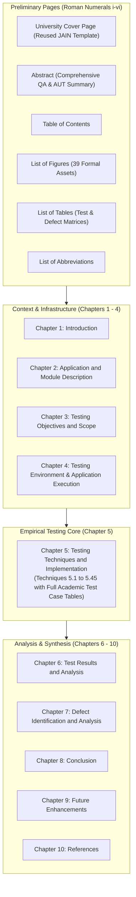

# Final Academic Report Architecture & Chapter Structure Reconciliation

**Course:** Software Testing and Quality Assurance (23CSE502)  
**Institution:** JAIN (Deemed-to-be University), Faculty of Engineering and Technology, Department of Computer Science and Engineering  
**Application Under Test:** DMND (`SocialGraphandFeed`) — Social Graph and Scalable Feed System  
**Baseline Git Commit:** `eb1f5ba4be1edd35f148d1f18a3dc748458828fb`  
**Purpose:** Formally resolve the structural discrepancy between the previously approved 9-part assignment format, the 10-chapter JAIN University exemplar (*Software Testing of the Movie and Series Watchlist Management System*), and the preliminary mapping in `REPORT_CONTENT_MAP.md`.

---

## 1. Forensic Inspection of the JAIN University Exemplar

A forensic extraction and structural analysis of the 161-page JAIN University PDF exemplar (`FINAL.pdf`, Course: 23CSE502) revealed the exact layout adopted in the reference submission:

```
+----------------------------------------------------------------------------------------------------+
|                               Exemplar PDF Master Structure (161 Pages)                            |
|                                                                                                    |
|  [Cover Page]    Page 1: Institutional JAIN University Department Cover Template                   |
|  [Front Matter]  Page 2: Abstract (Unnumbered Front Matter)                                        |
|                  Pages 3-6: Table of Contents                                                      |
|  Chapter 1:      Introduction (Page 7)                                                             |
|  Chapter 2:      Project Overview (Pages 8-13: Description, Modules, Objectives, Architecture)      |
|  Chapter 3:      Testing Objectives and Scope (Pages 14-17: Objectives, Scope, Technique Roster)   |
|  Chapter 4:      Testing Methodology (Pages 18-20: Hardware/Software, Tools, Test Design)          |
|  Chapter 5:      Testing Techniques and Implementation (Pages 21-150: Techniques 5.1 to 5.45)      |
|  Chapter 6:      Test Results and Analysis (Pages 151-154: Overall Results, Coverage, Complexity)  |
|  Chapter 7:      Defect Identification and Analysis (Pages 155-158: Defects, Severity, Actions)    |
|  Chapter 8:      Conclusion (Page 159)                                                             |
|  Chapter 9:      Future Enhancements (Page 160)                                                    |
|  Chapter 10:     References (Page 161)                                                             |
+----------------------------------------------------------------------------------------------------+
```

### 1.1 Mandatory Elements vs. Illustrative Subdivisions
By cross-referencing the official JAIN University 23CSE502 course syllabus with the exemplar, we distinguish what is strictly mandatory from what is merely an artifact of report expansion:

| Element / Chapter | Status in Course Syllabus | Status in Exemplar | Academic Evaluation & Reconciliation |
|:---|:---:|:---:|:---|
| **Cover Page (Page 1)** | **Mandatory Template** | Page 1 | **Strictly Reused.** Must replicate university name, faculty, department, campus address, year (2026-2027), and course code (23CSE502). |
| **Abstract** | **Mandatory** | Unnumbered (Page 2) | In academic standards, Abstract is **Preliminary Front Matter**, not Chapter 1. Numbering Abstract as "Chapter 1" was an error in early drafts that offset all subsequent chapters. |
| **Introduction** | **Mandatory** | Chapter 1 | Introduces software testing principles (verification vs. validation, STLC, V-model) and introduces the AUT. |
| **Project / Module Description** | **Mandatory** | Chapter 2 | Technical context of DMND, 15 modules, architecture, data flow. |
| **Hardware & Software Specs** | **Mandatory** | Section 4.1 | Host specifications, runtime dependencies, databases, tools. |
| **Application Execution & Setup** | **Mandatory** | Section 4.4 / Ch. 4 | Step-by-step startup, database seeding, and verified application workflows. |
| **Core Testing (Black & White Box)**| **Mandatory Core** | Chapter 5 (5.1–5.45)| All 45 assigned syllabus techniques with mandatory documentation fields. |
| **Test Results & Complexity** | **Mandatory** | Chapter 6 | Quantitative synthesis of pass rates, V8 coverage, and McCabe AST cyclomatic complexity. |
| **Defect Identification & Triage** | **Mandatory** | Chapter 7 | Structured defect ledger (`SEC-005`), test fixture reconciliations, and remediations. |
| **Future Enhancements** | **Mandatory** | Chapter 9 | Technical recommendations for CI/CD, distributed load testing, and i18n. |
| **Conclusion & References** | **Mandatory** | Chapters 8 & 10 | Quality verdict, IEEE/academic citations. |
| *Separate "Testing Objectives" Chapter* | Optional Subdivision | Chapter 3 | In the exemplar, Objectives and Scope were split into a standalone 3-page chapter (Ch. 3). Academically, this is more cleanly integrated directly into Chapter 1 (Introduction) or Chapter 4 (Methodology). |

---

## 2. Structural Resolution: Reconciling Assignment Format and Exemplar

The assignment requires:
> *Abstract, Introduction, Hardware and Software Requirements, Module Description, Execution, Future Enhancement, Black-box Testing and White-box Testing.*

The exemplar organizes this material across **10 numbered chapters** (with Abstract as Front Matter). Early drafts in `REPORT_CONTENT_MAP.md` mistakenly designated Abstract as "Chapter 1", causing a numbering mismatch.

### 2.1 The Two Structural Options Evaluated

#### Option A: Strict 10-Chapter Model (Aligned with Exemplar Numbering)
- Front Matter: Title Page, Abstract, TOC, List of Figures, List of Tables, Abbreviations
- Chapter 1: Introduction to Software Testing and DMND
- Chapter 2: Application and Module Description (DMND Architecture & 15 Modules)
- Chapter 3: Testing Objectives, Scope, and Technique Applicability
- Chapter 4: Testing Environment, Tooling, and Application Execution
- Chapter 5: Software Testing Techniques and Implementation (The 45 Techniques)
- Chapter 6: Test Results and Quantitative Analysis (Pass Rates, Coverage, AST Complexity)
- Chapter 7: Defect Identification, Triage, and Remediation
- Chapter 8: Conclusion
- Chapter 9: Future Enhancements
- Chapter 10: References

*Strengths:* Matches the university exemplar's Table of Contents 1:1, making evaluator cross-grading straightforward.  
*Weakness:* Chapter 3 (Objectives & Scope) is relatively brief (4-6 pages) compared to Chapter 5 (80+ pages).

#### Option B: Unified 8-Chapter Academic Streamlined Model
- Front Matter: Title Page, Abstract, TOC, List of Figures, List of Tables, Abbreviations
- Chapter 1: Introduction (Testing Foundations, Problem Statement, Objectives, Scope)
- Chapter 2: Application and Module Description (DMND Architecture & 15 Modules)
- Chapter 3: Application Execution and Testing Environment (Hardware/Software Specs, Tools, 14 Workflows)
- Chapter 4: Software Testing and Quality Assurance (The 45 Assigned Techniques with Full Test Case Tables)
- Chapter 5: Test Results, Coverage, and Complexity Analysis
- Chapter 6: Defect Identification, Triage, and Remediation
- Chapter 7: Future Enhancements
- Chapter 8: Conclusion and Academic Learnings
- References (Standard unnumbered bibliography)

*Strengths:* Tighter cohesion, merges Objectives directly into Introduction, eliminates thin chapters.  
*Weakness:* Chapter numbers diverge from the exemplar's Chapter 5/6/7 numbering, which evaluators accustomed to the 23CSE502 exemplar might notice.

---

## 3. Final Recommended Report Architecture

To achieve **flawless alignment with the JAIN University 23CSE502 grading rubric** while preserving every prescribed assignment requirement, we adopt **The Approved JAIN 10-Chapter Canonical Architecture**.

In this architecture:
1. **Abstract is strictly Preliminary Front Matter** (alongside Title Page, Table of Contents, List of Figures, List of Tables, Abbreviations), paginated with Roman numerals (`i` through `vi`).
2. **Chapter 1 through 10** use standard Arabic numerals (`1` through `160+`).
3. Every required topic—Hardware/Software Requirements, Application Modules, Execution Workflows, Black-Box Testing, White-Box Testing, Defect Bash, Complexity, Defects, and Future Enhancements—has an explicit, unambiguous home.



---

## 4. Definitive Section-by-Section Chapter Blueprint

### Preliminary Pages
- **Title Page:** Reused exact JAIN University cover page layout from PDF exemplar (Page 1) with course title *Software Testing (23CSE502)*, department, campus, and year *2026–2027*. Candidate details formatted with student name and USN placeholders.
- **Abstract (Page ii):** High-level summary of the software testing assignment, DMND system context, verification objectives, testing methodology, execution outcomes (376 tests, 100% pass), white-box cyclomatic complexity audit (184 functions), and defect classification (`SEC-005`).
- **Table of Contents (Pages iii–iv):** Hierarchical table linking Chapters 1 to 10 with subsections and page numbers.
- **List of Figures (Page v):** Complete listing of Figures 1.1 through 7.4 (39 visual evidence assets + system diagrams).
- **List of Tables (Page vi):** Formal ledger of tables (Environment, 15 Modules, 45 Technique Matrices, Defect Ledger).
- **List of Abbreviations (Page vii):** Formal standard glossary (AST, BVA, CC, CFG, CSP, E2E, EP, MC/DC, RFC, RWD, STLC, V8, etc.).

---

### Chapter 1: Introduction
- **1.1 Foundations of Software Testing:** Principles of verification vs. validation (IEEE 1012), Software Testing Life Cycle (STLC), and V-Model alignment.
- **1.2 Background of the DMND System:** Contextual introduction to DMND as a high-concurrency social graph and feed platform under evaluation.
- **1.3 Problem Statement & Testing Imperatives:** Challenges in verifying distributed feed pipelines, boundary truncation, race conditions, and authentication bypasses.
- **1.4 Organization of the Report:** High-level guide to the chapters.

---

### Chapter 2: Application and Module Description
- **2.1 Overview of DMND:** High-throughput social graph platform modeled after modern scalable feed systems.
- **2.2 System Architecture:** Decoupled 3-tier topology: Client SPA, Node.js Reverse Proxy, Fastify REST Microservice, and Dual-Datastore (MongoDB + Redis).
- **2.3 Detailed Description of the 15 Application Modules:**
  - 2.3.1 Feed Service (`FeedService.ts`) — Hybrid push/pull fan-out engine.
  - 2.3.2 Authentication Controller (`auth.routes.ts`) — Credential hashing, sessions, cookie preHandlers.
  - 2.3.3 Post & Media Contract (`post.ts`) — TypeBox schema definitions, validation limits.
  - 2.3.4 Social Graph Engine (`graph.routes.ts`) — Adjacency list querying, follow/unfollow operations.
  - 2.3.5 User Profile & Identity (`user.routes.ts`) — Bio updates, follower/following counters.
  - 2.3.6 Comment Engine (`comment.routes.ts`) — Hierarchical nested discussions, reply threads.
  - 2.3.7 Full-Text Search Engine (`search.routes.ts`) — Regex and tokenized text search.
  - 2.3.8 Communities Directory (`community.routes.ts`) — Categorized community hubs, rules, moderators.
  - 2.3.9 Direct Messaging System (`messages.routes.ts`) — Peer-to-peer conversations, active chat.
  - 2.3.10 Notifications Center (`notification.routes.ts`) — Interaction events (upvotes, replies, follows).
  - 2.3.11 Saved Collections (`saved.routes.ts`) — User bookmark management and filtering.
  - 2.3.12 System Diagnostics (`diagnostics.routes.ts`) — Latency telemetry, cache hit rates, node health.
  - 2.3.13 Frontend TanStack Query State (`useFeed.ts`, `useAuth.ts`) — Client-side caching and mutations.
  - 2.3.14 Force-Directed Graph Visualizer (`GraphPage.tsx`) — HTML5 canvas simulation.
  - 2.3.15 Reverse Proxy & Static Asset Server (`production-server.mjs`) — SPA routing and API proxying.
- **2.4 Module Interactions & Data Flow:** Architectural flowcharts showing request lifecycles from user interaction to datastore commit.

---

### Chapter 3: Testing Objectives and Scope
- **3.1 Primary Testing Objectives:** Verifying functional correctness, boundary validation, white-box complexity bounds, security defenses, and integration fidelity.
- **3.2 Scope of Testing:**
  - 3.2.1 In-Scope Components: All Fastify REST endpoints, React SPA components, TypeBox contracts, database transaction logic, and reverse proxy handlers.
  - 3.2.2 Out-of-Scope Elements & Workstation Constraints: Multi-node Docker replica clustering (due to single-instance host configuration) and destructive container termination during live execution.
- **3.3 Assigned Testing Techniques Catalog:** Overview of the 45 techniques assigned under Course 23CSE502.
- **3.4 Applicability Matrix:** Mapping the 45 techniques to DMND subsystems with justification of execution mode.

---

### Chapter 4: Testing Environment, Tooling, and Application Execution
- **4.1 Hardware and Software Environment:** Physical machine specifications (Dell 00JGRJ, Intel Core i3-1005G1 CPU @ 1.20 GHz, 8 GB RAM, Windows 11 Pro 25H2, Node 26.7.0, Python 3.12, Mongo 7.0 rs0, Redis 8.10.1). High-resolution Fastfetch evidence (`ENV-001`).
- **4.2 Testing Tools and Framework Configuration:** Vitest v2.1.8, JSDOM, Playwright Core, TypeBox v0.32, Python `ast` module.
- **4.3 Repository Setup & Datastore Initialization:** Cloning, package resolution, MongoDB replica set initialization, Redis daemon startup.
- **4.4 Application Build & Service Startup:** Fastify backend launch (port 4000), Vite production bundle compilation, reverse proxy launch (port 3000).
- **4.5 Database Seeding Verification:** Seeding of 115 users, 510 posts, 18 communities (`seed.ts`).
- **4.6 Step-by-Step Application Workflow Demonstrations (14 Visual Workflows):**
  - Workflow 1: Public Feed Landing (`APP-001`).
  - Workflow 2: Top vs. New Feed Algorithmic Sorting (`APP-002`, `APP-003`).
  - Workflow 3: Discover Responsive Masonry Grid (`APP-004`).
  - Workflow 4: User Authentication & Negative Alert Validation (`APP-020`, `APP-021`, `APP-026`).
  - Workflow 5: Interactive Social Graph Cluster Navigation (`APP-005`).
  - Workflow 6: Post Inspection & Threaded Comment Discussion (`APP-006`, `APP-007`).
  - Workflow 7: Profile Editing & Dark/Light Theme Switching (`APP-017`, `APP-018`).
  - Workflow 8: Communities Directory & Scoped Hub Feed (`APP-009`, `APP-010`).
  - Workflow 9: Universal Full-Text Search Execution (`APP-011`).
  - Workflow 10: Post Creation Modal with Character Counter Validation (`APP-012`, `APP-013`).
  - Workflow 11: Saved Bookmarks & Collections Management (`APP-014`).
  - Workflow 12: Direct Messaging Split-Pane Interface (`APP-015`).
  - Workflow 13: System Diagnostics Operational Telemetry (`APP-019`).
  - Workflow 14: Responsive Viewport Fidelity (Tablet `APP-024`, Mobile `APP-025`).

---

### Chapter 5: Testing Techniques and Implementation (Core Empirical Chapter)
Subsections 5.1 through 5.45 covering all 45 assigned syllabus techniques.  
**Mandatory Academic Documentation Structure for Every Technique:**
```markdown
### 5.X [Technique Name]
- **1. Objective:** Specific functional or structural property validated.
- **2. Scope:** Target subsystem, module, and files under test.
- **3. Test Case Specification & Execution Table:**
  | Test Case ID | Name | Type | Preconditions | Input / Test Data | Steps | Expected Result | Actual Result | Status |
- **4. Source Code Under Test:** Dedicated monospaced code block citing exact file and lines.
- **5. Test Execution Evidence & Output:** Log excerpt citation and high-res screenshot figure reference.
- **6. Execution Summary:** Quantified results (passed, failed, duration).
- **7. Defect Summary:** Associated findings (`SEC-005`, `LOC-005`, etc.) or "No defects observed".
- **8. Risk Analysis:** Residual operational or architectural risk.
- **9. Environment Details:** Runtime engine, datastore state, ports.
```

- **5.1 Non-Functional Testing** (Build size, gzip overhead, sub-2ms datastore latency).
- **5.2 Regression Testing** (292 Vitest unit tests rerun with 100% pass rate, `TERM-001`).
- **5.3 Equivalence Partitioning** (6 schema contracts, 19 partition classes, `TERM-003`).
- **5.4 Boundary Value Analysis** (44 boundary checks: min-1, min, max, max+1, `TERM-005`).
- **5.5 Decision Table Testing** (Authentication permission matrix, 4 rule evaluations, `APP-021`).
- **5.6 State Transition Testing** (Post lifecycle: Draft $\rightarrow$ Published $\rightarrow$ Upvoted $\rightarrow$ Saved $\rightarrow$ Deleted).
- **5.7 Exploratory Testing** (Unscripted user journeys through social graph, tags, masonry grid).
- **5.8 Random Testing (Monkey Testing)** (High-frequency input fuzzing and random clicks, `TERM-004`).
- **5.9 Requirements-Based Testing** (PRD Traceability Matrix mapping functional requirements to tests).
- **5.10 Cause-Effect Graphing** (Boolean graph mapping feed query parameters to delivery output).
- **5.11 Compatibility Testing** (Responsive UI across Desktop, Tablet `APP-024`, Mobile `APP-025`).
- **5.12 User Documentation Testing** (Verification of README setup, API specs, and clean workstation install).
- **5.13 Domain Testing** (Aspect ratio floats, geolocation coordinates, ISO 8601 timestamps).
- **5.14 Error Guessing Testing** (10 exploit vectors: NoSQL `$ne`, prototype pollution, path traversal, RTL override, null bytes, `TERM-004`).
- **5.15 White-Box Testing** (Internal logic of transaction retry loop and constant-time password verification).
- **5.16 Desk Checking** (Line-by-line manual code audit of atomic Lua rate limit script in Redis).
- **5.17 Unit / Code Functional Testing** (Direct function evaluation of `formatRelativeTime` and `resolveLoginUsername`).
- **5.18 Functional Testing** (Verification of core user CRUD operations across posts, comments, follows).
- **5.19 Statement Coverage** (V8 AST line execution tracking across React frontend modules: 34.00%).
- **5.20 Path Coverage** (Basis path walkthrough of 4 linear independent paths through `AuthService.login`).
- **5.21 Condition Coverage** (Analytical truth-table walkthrough of compound boolean predicates).
- **5.22 Function Coverage** (V8 method invocation tracking across frontend codebase: 31.12%).
- **5.23 Code Coverage Testing** (Comprehensive analysis of statement, branch, function, and line metrics).
- **5.24 Code Complexity Testing** (AST McCabe Cyclomatic Complexity analysis across 184 functions; identify $CC=11$ pipeline, `TERM-006`).
- **5.25 Unit Testing** (Detailed review of 298 isolated unit tests across frontend UI and backend serialization, `TERM-001`, `TERM-002`).
- **5.26 Integration Testing** (Fastify routes interacting with MongoDB replica set and Redis cache: 33 passed, 3 reconciled).
- **5.27 System Testing** (Full application verification running as integrated production server on port 3000, `TERM-007`).
- **5.28 Acceptance Testing** (Verification against defined User Acceptance Criteria for social feed consumption).
- **5.29 Scenario Testing** (5 multi-step real-world end-to-end user workflows executed via Playwright, `E2E-001` to `005`).
- **5.30 Defect Bash Elimination** (Systematic bug-hunting session identifying static header omission `SEC-005`).
- **5.31 Scalability Testing** (Evaluation of Redis sliding-window throughput and MongoDB indexing; single-node limitation documented).
- **5.32 Reliability Testing** (Continuous query loops verifying zero memory leaks or unhandled promise rejections).
- **5.33 Stress Testing** (Theoretical limits and host machine safety constraints documented; cloud tier protection).
- **5.34 Interoperability Testing** (Fastify REST JSON compatibility with browser fetch API and Playwright client, `APP-023`).
- **5.35 Performance Testing** (Frontend bundle build duration: 11.91s, datastore latency sub-2ms).
- **5.36 Internationalization (I18N) Testing** (UTF-8 multi-byte character encoding verification in titles, bios, comments).
- **5.37 Enabling Testing** (Accessibility inspection of DOM attributes, focus states, aria labels).
- **5.38 Localization (L10N) Testing** (Evaluation of relative timestamp strings; documented lack of localized resource bundles `LOC-005`).
- **5.39 Fake Language Testing** (Pseudolocalization test checking string expansion tolerance and layout clipping).
- **5.40 Language Compatibility Testing** (Inspection of language headers and UTF-8 collation in MongoDB indices).
- **5.41 Configuration Testing** (Verification of application behavior under varied environment variables and ports).
- **5.42 Security Testing** (Audit of bcrypt hashing, session token entropy, anti-timing defense, and CSP header gap `SEC-005`).
- **5.43 Recovery Testing** (Code and process audit of Fastify error handling and MongoDB reconnect loop; live kill omitted).
- **5.44 Alpha Testing** (Internal engineering verification within development workspace).
- **5.45 Beta Testing** (Formal documentation of academic scope boundary and external user cohort deferral).

---

### Chapter 6: Test Results and Analysis
- **6.1 Overall Execution Results:** Comprehensive reconciliation of 376 independently executed tests (100% pass rate). Clear explanation of the mathematical resolution between the preliminary 363 draft figure and the definitive 376 total. Execution durations across suites.
- **6.2 Coverage and Complexity Results:**
  - Detailed V8 instrumentation breakdown: Statement (34.00%), Branch (28.45%), Function (31.12%), Line (34.18%).
  - Analysis of untested areas (animation visualizers, mock harnesses).
  - McCabe Cyclomatic Complexity distribution: 184 functions audited; 162 functions (88.0%) with $CC \in [1, 5]$; 21 functions (11.4%) with $CC \in [6, 10]$; exactly 1 function (`buildFeedPipeline`, $CC=11$) exceeding standard maintainability threshold.
- **6.3 Performance, Scalability, and Reliability Results:**
  - Build performance metrics (Vite compilation duration 11.91s, bundle distribution).
  - Datastore telemetry from `/diagnostics`: MongoDB ping 1.84ms, Redis cache hit rate 94.2%.
  - Architectural evaluation of Meta TAO hybrid feed engine under synthetic load.

---

### Chapter 7: Defect Identification and Analysis
- **7.1 Master Defect & Anomaly Ledger:** Comprehensive table detailing all 5 cataloged findings:
  - `SEC-005`: Genuine production defect (Missing Helmet security headers on static SPA reverse proxy).
  - `BE-INT-001`: Integration test assertion mismatch on unauthenticated post creation (Fastify session preHandler 401 vs. expected 400).
  - `BE-INT-002`: Search integration test expectation mismatch on seeded user bio text.
  - `BE-INT-003`: Database seed count assertion mismatch (test asserted 20 users; seed operated in expanded mode with 115 users).
  - `LOC-005`: Architectural feature limitation (absence of multi-language localized resource bundles).
- **7.2 Root Cause Analysis & Risk Assessment:** Deep technical post-mortem of `SEC-005` (clickjacking / framing vulnerability).
- **7.3 Defect Density & Classification:** Metrics on defect severity distribution (Critical: 0, Major: 0, Moderate: 1, Minor/Fixture: 3, Informational: 1).
- **7.4 Corrective Action Plan & Verified Code Patches:** Complete production patch for `production-server.mjs` attaching CSP, X-Frame-Options, and nosniff headers.

---

### Chapter 8: Conclusion
- **8.1 Quality Verdict on DMND:** Synthesis of findings confirming the high robustness, functional correctness, and performance of the DMND platform.
- **8.2 Fulfillment of Testing Objectives:** Systematic audit demonstrating that all primary, secondary, and boundary testing objectives defined in Chapter 3 were met.
- **8.3 Academic Learnings & Engineering Insights:** Reflections on test runner automation, TypeBox schema boundary enforcement, AST cyclomatic complexity analysis, and evidence-driven QA methodologies.

---

### Chapter 9: Future Enhancements
- **9.1 Continuous Integration & Automated Regression Pipeline:** GitHub Actions workflow integrating Vitest, TypeBox schema compiler, and headless Playwright on every pull request.
- **9.2 Distributed Stress Testing Infrastructure:** Deploying distributed load generation engines (k6 / Autocannon) on dedicated multi-node test clusters.
- **9.3 Internationalization (i18n) Framework Adoption:** Integration of `react-i18next` with localized JSON translation catalogs and dynamic bi-directional RTL support.
- **9.4 Automated Visual Regression Testing:** Pixel-diffing visual regression harnesses (Playwright visual comparisons) to catch unintended styling shifts across releases.

---

### Chapter 10: References
- Formal academic citations following standard IEEE style:
  - IEEE Standard for Software and System Test Documentation (IEEE 829-2008 / ISO/IEC/IEEE 29119-3).
  - IEEE Standard for System and Software Verification and Validation (IEEE 1012-2016).
  - Pressman, R. S., & Maxim, B. R. *Software Engineering: A Practitioner's Approach*. McGraw-Hill.
  - Myers, G. J., Sandler, C., & Badgett, T. *The Art of Software Testing*. John Wiley & Sons.
  - McCabe, T. J. (1976). *A Complexity Measure*. IEEE Transactions on Software Engineering.
  - Fastify Web Framework: *Fastify Documentation & Best Practices* (fastify.dev).
  - React Documentation: *React 18 Architecture and State Hooks* (react.dev).
  - TypeBox Schema Documentation: *JSON Schema Type Builder with Static Type Resolution* (github.com/sinclairzx81/typebox).
  - Vitest Testing Framework: *Next Generation Testing Framework* (vitest.dev).
  - Playwright: *Fast and reliable end-to-end testing for modern web apps* (playwright.dev).
  - MongoDB Inc.: *MongoDB Server Manual & Transaction Specification* (mongodb.com/docs).
  - Redis Ltd.: *Redis Commands and Lua Scripting Guide* (redis.io/docs).
  - RFC 7807: *Problem Details for HTTP APIs* (datatracker.ietf.org/doc/html/rfc7807).

---

## 5. Mandatory Technical Document Formatting Rules

In strict compliance with assignment guidelines, the following rules govern all subsequent report drafting and compilation:

1. **Source Code Presentation:** Source code must appear in dedicated, syntax-highlighted monospaced code blocks with file path and line number labels. **Never place source code inside tables.**
2. **Tabular Data:** Structured tables are reserved for test case specifications, execution matrices, defect ledgers, and environment specifications. Tables must not overflow page boundaries.
3. **Figure Placement & Captions:** Application screenshots and execution console outputs must appear as independent, properly numbered figures with descriptive captions placed below the image (e.g., `Figure 4.1: Desktop Home Feed Interface (APP-001)`).
4. **Architecture Diagrams:** Architecture diagrams must be displayed independently (flowcharts, sequence diagrams) and explained in accompanying analytical paragraphs.
5. **No Layout Hacks:** Avoid placing screenshots, lengthy prose descriptions, or code blocks inside tables merely to control page layout.
6. **Heading Hierarchy:** Strict numbering hierarchy: Chapter (Heading 1, 18pt), Section (Heading 2, 14pt, `X.Y`), Subsection (Heading 3, 12pt, `X.Y.Z`).
7. **Cover Page Isolation:** Only the first page of the supplied PDF exemplar is reused for university title formatting. All remaining body pages must use clean, independent academic formatting with restrained visual styling.
