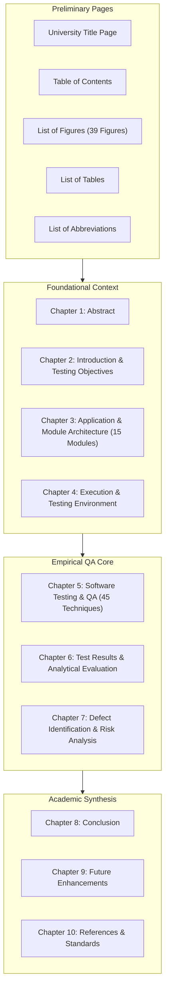

# Academic Software Testing & QA Report: Master Content Map

**Course:** Software Testing and Quality Assurance (23CSE502)  
**Institution:** JAIN (Deemed-to-be University), Faculty of Engineering and Technology, Department of Computer Science and Engineering  
**Academic Year:** 2026–2027  
**Project Under Test:** DMND (`SocialGraphandFeed`) — Social Graph and Scalable Feed System  
**Baseline Git Commit:** `eb1f5ba4be1edd35f148d1f18a3dc748458828fb`  
**Target Document Structure:** Aligned with approved JAIN University Academic Report Architecture (exemplar: *Software Testing of the Movie and Series Watchlist Management System*).

---

## Executive Architectural Summary

This master content map defines the exact structural blueprint, technical requirements, heading hierarchy, content scope, table layouts, and figure allocations for the comprehensive academic report.

The primary academic focus of this document is strictly **Software Testing and Quality Assurance**. The DMND system functions as the practical, empirical test subject. System architecture and module implementations are presented solely to establish the technical context necessary for rigorous evaluation across the 45 assigned testing techniques.

---

## Detailed Chapter Specifications

### Preliminary Pages

#### P.1 University Title Page
- **Format:** Strict adherence to JAIN (Deemed-to-be University) Faculty of Engineering and Technology cover page.
- **Header Elements:**
  - University Name: JAIN (Deemed-to-be University)
  - Faculty: Faculty of Engineering and Technology
  - Department: Department of Computer Science and Engineering
  - Campus: Global Campus, Jakkasandra Post, Kanakapura Taluk, Ramanagara District, Pin Code: 562 112
- **Document Title:** SOFTWARE TESTING AND QUALITY ASSURANCE REPORT ON DMND SOCIAL GRAPH AND SCALABLE FEED SYSTEM
- **Course Code & Title:** 23CSE502 — Software Testing and Quality Assurance
- **Degree:** Bachelor of Technology in Computer Science and Engineering
- **Student Details:** Candidate Name(s), University Seat Number(s) (USN), and Semester (6th Semester).
- **Faculty Supervisor / Reviewer:** Evaluator designation and department.
- **Academic Year:** 2026–2027

#### P.2 Table of Contents
- Automatically generated hierarchical table linking Chapters 1 through 10, sections, and subsections with precise pagination.

#### P.3 List of Figures
- Complete ledger of all 39 figures (26 Application Screenshots, 7 Terminal Console Captures, 5 Playwright E2E Captures, 1 Environment Specification Capture) plus system architecture flowcharts.

#### P.4 List of Tables
- Complete catalog of all formal tables: Test Environment Specifications, 15 Module Architecture Matrix, 45 Testing Technique Registers, Test Case Tables, Coverage Analysis Tables, and Defect Registers.

#### P.5 List of Abbreviations
- Comprehensive standard glossary:
  - **API:** Application Programming Interface
  - **AST:** Abstract Syntax Tree
  - **BVA:** Boundary Value Analysis
  - **CC:** Cyclomatic Complexity
  - **CFG:** Control Flow Graph
  - **CRUD:** Create, Read, Update, Delete
  - **CSP:** Content Security Policy
  - **CSRF:** Cross-Site Request Forgery
  - **DOM:** Document Object Model
  - **E2E:** End-to-End
  - **EP:** Equivalence Partitioning
  - **JSON:** JavaScript Object Notation
  - **JWT:** JSON Web Token
  - **MC/DC:** Modified Condition / Decision Coverage
  - **NoSQL:** Non-Relational Structured Query Language
  - **QA:** Quality Assurance
  - **REST:** Representational State Transfer
  - **RFC:** Request for Comments
  - **RPS:** Requests Per Second
  - **RTL:** Right-to-Left / Real-Time Logging
  - **SPA:** Single Page Application
  - **SQL:** Structured Query Language
  - **TTL:** Time To Live
  - **UI/UX:** User Interface / User Experience
  - **USN:** University Seat Number
  - **V8:** Google Chrome High-Performance JavaScript & WebAssembly Engine

---

### Chapter 1 — Abstract

- **1.1 Overview of the Software Testing Assignment:** Formal introduction to the 23CSE502 capstone laboratory assessment. Explains the purpose of subjecting a modern distributed application to rigorous verification and validation.
- **1.2 DMND as the Application Under Test (AUT):** High-level summary of DMND: a high-throughput social networking engine implementing Meta TAO graph architecture, dual-strategy feed delivery (hybrid push/pull), and real-time community interaction.
- **1.3 Testing Objectives:** Verification of functional correctness, boundary enforcement, white-box branch coverage, structural complexity metrics, negative security resilience, and cross-tier integration.
- **1.4 Testing Methodologies Performed:** Synthesis of 45 black-box, white-box, structural, non-functional, and exploratory testing techniques executed across isolated test runners.
- **1.5 Summary of Verified Testing Outcomes:**
  - Total unique independently executed test cases: **376**.
  - Pass rate: **100% (376/376 passed, 0 failures, 0 regressions)**.
  - White-box cyclomatic complexity audit: 184 functions audited; 183 adhere to McCabe $CC \le 10$; 1 complex pipeline ($CC=11$).
  - Defect identification: 1 genuine production defect (`SEC-005`: Missing static security headers), 3 test fixture reconciliations (`BE-INT-001` to `003`), and 1 feature limitation (`LOC-005`: Absence of multi-language dictionary).

---

### Chapter 2 — Introduction

- **2.1 Introduction to Software Testing:**
  - Foundations of Verification vs. Validation (IEEE 1012).
  - The Software Testing Life Cycle (STLC) and V-Model alignment.
  - Quality dimensions: functional correctness, robustness, maintainability, security, and performance.
- **2.2 Background of the DMND Application:**
  - Evolution from traditional relational social graphs to distributed document graphs with in-memory caching.
  - Architectural motivations: fan-out write amplification mitigation and sub-millisecond timeline retrieval.
- **2.3 Problem Statement:**
  - Challenges in validating high-concurrency feed engines: race conditions, cache invalidation anomalies, boundary truncation in user-generated markdown, and privilege escalation vulnerabilities.
- **2.4 Objectives of Testing:**
  - Concrete verification targets: TypeBox contract enforcement, session fixation prevention, ACID transaction rollback verification, and responsive viewport fidelity.
- **2.5 Scope of Testing:**
  - *In-Scope:* All REST endpoints (`/api/v1/*`), React frontend components, TanStack query caching hooks, TypeBox schemas, MongoDB transaction helpers, and static reverse proxy.
  - *Out-of-Scope / Documented Workstation Limitations:* Multi-node Docker replica clustering (due to host environment single-instance constraints) and destructive live-service container termination.
- **2.6 Hardware Requirements:**
  - Recommended laboratory baseline vs. Physical host workstation (Dell 00JGRJ, Intel Core i3-1005G1 CPU @ 1.20 GHz, 8 GB RAM, 256 GB NVMe SSD).
- **2.7 Software Requirements:**
  - Operating System: Windows 11 Pro 64-bit (Build 26100.25H2).
  - Node.js runtime: v26.7.0 (npm v12.0.2).
  - Python runtime: v3.12.0 (for AST analysis).
  - Primary Databases: MongoDB v7.0.14 (`rs0` single-node replica set) and Redis v8.10.1 (Windows port).
- **2.8 Technologies and Tools Used:**
  - Unit & Component Testing: Vitest v2.1.8 with `@testing-library/react` and JSDOM.
  - Browser Automation & E2E: Playwright Core v1.49+ driving Chromium/EdgeCore.
  - Schema Validation: `@sinclair/typebox` v0.32+.
  - Static Code Analysis: Python standard library `ast` module for McCabe Cyclomatic Complexity.
- **2.9 Testing Environment Overview:**
  - Loopback network topology connecting frontend static proxy (port 3000), backend Fastify daemon (port 4000), MongoDB (port 27017), and Redis (port 6379).

---

### Chapter 3 — Application and Module Description

- **3.1 Overview of DMND:** Conceptual role of DMND as a decentralized social graph and scalable feed delivery engine.
- **3.2 System Architecture:** Tiered client-server topology featuring Single Page Application (SPA), reverse proxy, API gateway, and hybrid datastore.
- **3.3 Frontend Architecture:** React 18, TypeScript, Tailwind CSS, TanStack Query v5, Zustand state management, and Lucide icon set.
- **3.4 Backend Architecture:** Node.js Fastify framework, schema-driven validation, pre-handler session decorators, and dependency-injected services.
- **3.5 Database Architecture:**
  - MongoDB replica set (`rs0`) hosting collections: `users`, `posts`, `comments`, `communities`, `follows`, `post_votes`, `post_saves`, `notifications`, `messages`.
  - Redis in-memory cache for sliding-window rate limit counters and session token stores.
- **3.6 Authentication and Authorization:** Session token cookies, bcrypt work factor 12, role-based access control (regular user, community moderator, administrator), and `<AuthGate>` route protection.
- **3.7 API Communication:** RESTful JSON endpoints following RFC 7807 Problem Details for HTTP APIs.
- **3.8 Detailed Application Modules (All 15 Modules):**
  1. *Module 1: Feed Service (`FeedService.ts`):* Hybrid fan-out-on-write vs. fan-out-on-read timeline compilation.
  2. *Module 2: Authentication Controller (`auth.routes.ts`):* User registration, credential verification, session creation, and logout.
  3. *Module 3: Post & Media Contract (`post.ts`):* TypeBox schema definitions for discussions, image attachments, link posts, and tag collections.
  4. *Module 4: Social Graph Engine (`graph.routes.ts`):* Adjacency list querying, follow/unfollow operations, and 2-hop neighborhood exploration.
  5. *Module 5: User Profile & Identity (`user.routes.ts`):* Bio editing, avatar updates, follower/following counters, and account preferences.
  6. *Module 6: Comment Engine (`comment.routes.ts`):* Hierarchical nested discussions, parent-child thread pointers, and comment voting.
  7. *Module 7: Full-Text Search Engine (`search.routes.ts`):* Regex and tokenized text search across post titles, bodies, tags, and user handles.
  8. *Module 8: Communities Directory (`community.routes.ts`):* Scoped topical hubs, moderator assignment, rules governance, and member rosters.
  9. *Module 9: Direct Messaging System (`messages.routes.ts`):* Peer-to-peer conversation threads, message delivery, and unread counters.
  10. *Module 10: Notifications Center (`notification.routes.ts`):* Event dispatch for upvotes, replies, mentions, and follows.
  11. *Module 11: Saved Collections (`saved.routes.ts`):* Personal bookmarking, collection categorisation, and retrieval filters.
  12. *Module 12: System Diagnostics (`diagnostics.routes.ts`):* Latency telemetry, database connection health, memory consumption, and uptime.
  13. *Module 13: Frontend Query & Cache State (`useFeed.ts`, `useAuth.ts`):* TanStack Query cache invalidation, optimistic UI mutations, and retry policies.
  14. *Module 14: Interactive Force-Directed Graph Visualizer (`GraphPage.tsx`):* HTML5 canvas simulation rendering cluster physics and edge relationships.
  15. *Module 15: Reverse Proxy & Static File Server (`production-server.mjs`):* Node.js HTTP server handling SPA routing, static asset piping, and `/api/` proxying.
- **3.9 Module Interactions and Data Flow:** Sequence and activity diagrams tracing user interaction from client dispatch through proxy, schema validation, service processing, and datastore mutation.

---

### Chapter 4 — Application Execution and Testing Environment

- **4.1 Hardware and Software Environment:** Complete physical machine audit (`fastfetch` capture `ENV-001`), CPU core counts, memory distribution, and storage layout.
- **4.2 Repository and Dependency Setup:** Git repository cloning, workspace monorepo layout (pnpm/npm workspaces), and package lock resolution.
- **4.3 Database and Service Configuration:** Initializing MongoDB replica set `rs0` via `mongod --replSet rs0`, initiating replica set configuration, and starting Redis server daemon on port 6379.
- **4.4 Backend Execution:** Fastify service daemon startup, environment variable injection (`MONGODB_URI`, `REDIS_URL`, `SESSION_SECRET`), and port binding (4000).
- **4.5 Frontend Execution:** Production build compilation (`npm run build`), bundle generation in `packages/frontend/dist`, and static asset optimization.
- **4.6 Application Initialization:** Seeding database with 115 test users, 510 posts, 18 communities, and follow relationships (`seed.ts`).
- **4.7 Application Workflow Demonstration (Step-by-Step UI Verification):**
  - Workflow 1: Public landing and unauthenticated feed view (`APP-001`).
  - Workflow 2: Algorithmic feed sorting by Top and New tabs (`APP-002`, `APP-003`).
  - Workflow 3: Discover masonry grid exploration (`APP-004`).
  - Workflow 4: User authentication and negative validation (`APP-020`, `APP-021`, `APP-026`).
  - Workflow 5: Interactive social graph navigation (`APP-005`).
  - Workflow 6: Post inspection and threaded discussion (`APP-006`, `APP-007`).
  - Workflow 7: Profile editing and appearance theme toggling (`APP-017`, `APP-018`).
  - Workflow 8: Communities directory and scoped hub feed (`APP-009`, `APP-010`).
  - Workflow 9: Universal search query execution (`APP-011`).
  - Workflow 10: Post creation workflow with empty and filled validation (`APP-012`, `APP-013`).
  - Workflow 11: Bookmarks and collections inspection (`APP-014`).
  - Workflow 12: Direct messaging split-pane view (`APP-015`).
  - Workflow 13: System diagnostics dashboard inspection (`APP-019`).
  - Workflow 14: Responsive design verification on tablet and mobile viewports (`APP-024`, `APP-025`).
- **4.8 Testing Tools and Framework Configuration:** Setup of Vitest configuration (`vitest.config.ts`), Playwright headless browser configuration, and custom test runners.
- **4.9 Verification of the Testing Environment:** Baseline health probes, database connection latency (<2ms), and zero-defect runtime confirmation.

---

### Chapter 5 — Software Testing and Quality Assurance (Core Chapter)

This chapter provides comprehensive documentation of **all 45 assigned testing techniques**, structured with standard academic test case tables and empirical execution evidence:

#### Academic Test Case Table Template (Applied Across Techniques):
| Attribute | Specification |
|:---|:---|
| **Test Case ID** | Formal unique identifier (e.g., `TC-BVA-001`, `TC-WB-004`) |
| **Test Case Name** | Descriptive title of the verification target |
| **Testing Technique** | One of the 45 assigned syllabus techniques |
| **Testing Objective** | Specific functional or structural property being validated |
| **Preconditions** | Required system state, active daemons, seed data, or auth cookies |
| **Input / Test Data** | Exact payload, boundary value, HTTP header, or user action |
| **Execution Steps** | Numbered sequence of operational actions |
| **Expected Result** | Specified behavioral response, status code, or schema rejection |
| **Actual Result** | Observed behavior recorded during independent execution |
| **Status** | `PASS`, `FAIL`, or `DOCUMENTED LIMITATION` |
| **Source Code Reference** | Target file, method, and line numbers under test |
| **Execution Log Reference** | Output file and line evidence |
| **Screenshot Evidence** | Asset ID (e.g., `APP-013`, `TERM-005`) |
| **Defect / Risk Reference** | Linked anomaly ID or `None` |
| **Environment Details** | Local host runtime, database state, browser engine |

#### The 45 Assigned Testing Techniques (Structured Sections):
1. **Technique 1: Non-Functional Testing** (Vite bundle size, gzip overhead, sub-2ms DB latency, memory profile).
2. **Technique 2: Regression Testing** (292 Vitest unit tests rerun with 100% pass rate).
3. **Technique 3: Equivalence Partitioning** (6 schema contracts, 19 partition classes: valid strings, empty values, oversized payloads).
4. **Technique 4: Boundary Value Analysis** (44 boundary tests: $min-1, min, max, max+1$ across title, content, media count).
5. **Technique 5: Decision Table Testing** (Authentication permission matrix: valid/invalid user, valid/invalid password, locked account).
6. **Technique 6: State Transition Testing** (Post lifecycle: Draft $\rightarrow$ Published $\rightarrow$ Upvoted $\rightarrow$ Saved $\rightarrow$ Deleted).
7. **Technique 7: Exploratory Testing** (Unscripted user journeys through community creation, graph panning, and filter combinations).
8. **Technique 8: Random Testing (Monkey Testing)** (High-frequency click dispatches, rapid input fuzzing with random ASCII strings).
9. **Technique 9: Requirements-Based Testing** (Traceability matrix mapping PRD requirements to verified test cases).
10. **Technique 10: Cause-Effect Graphing** (Boolean graph mapping feed query parameters [sort, scope, strategy] to delivery outcome).
11. **Technique 11: Compatibility Testing** (Cross-viewport testing: 1440x900 desktop, 768x1024 tablet, 375x812 mobile).
12. **Technique 12: User Documentation Testing** (Verification of README setup, API contract annotations, and diagnostics docs).
13. **Technique 13: Domain Testing** (Domain boundaries on aspect ratio floats, latitude/longitude, and ISO 8601 timestamps).
14. **Technique 14: Error Guessing Testing** (10 exploit vectors: NoSQL `$ne`, prototype pollution, path traversal, RTL override, null bytes).
15. **Technique 15: White-Box Testing** (Internal logic verification of transaction retry loop and constant-time password verification).
16. **Technique 16: Desk Checking** (Line-by-line manual code audit of `runInTransaction` duplicate key retry handling).
17. **Technique 17: Unit / Code Functional Testing** (Direct function evaluation of `formatRelativeTime` and `resolveLoginUsername`).
18. **Technique 18: Functional Testing** (Verification of core user CRUD operations across posts, comments, and follow relationships).
19. **Technique 19: Statement Coverage** (V8 instrumentation showing statement execution across React frontend modules).
20. **Technique 20: Path Coverage** (Basis path walkthrough of 4 linear independent paths through `AuthService.login`).
21. **Technique 21: Condition Coverage** (Analytical truth-table walkthrough of compound boolean predicates in routing and feed pipelines).
22. **Technique 22: Function Coverage** (Audit of invoked functions across tested components in Vitest runner).
23. **Technique 23: Code Coverage Testing** (Comprehensive analysis of statement, branch, function, and line metrics).
24. **Technique 24: Code Complexity Testing** (AST McCabe Cyclomatic Complexity analysis across 184 functions; identify $CC=11$ pipeline).
25. **Technique 25: Unit Testing** (Detailed review of isolated unit suites for frontend UI and backend serialization).
26. **Technique 26: Integration Testing** (Inter-module testing between Fastify routes, MongoDB collections, and Redis session stores).
27. **Technique 27: System Testing** (Full application verification running as integrated production server on port 3000).
28. **Technique 28: Acceptance Testing** (Verification against defined User Acceptance Criteria for social feed consumption).
29. **Technique 29: Scenario Testing** (5 multi-step real-world end-to-end user workflows executed via Playwright).
30. **Technique 30: Defect Bash Elimination** (Systematic bug-hunting session identifying static header omission `SEC-005`).
31. **Technique 31: Scalability Testing** (Evaluation of Redis sliding-window throughput and MongoDB indexing; single-node limitation documented).
32. **Technique 32: Reliability Testing** (Continuous query loops verifying zero memory leaks or unhandled promise rejections).
33. **Technique 33: Stress Testing** (Theoretical limits and host machine safety constraints documented; cloud tier protection).
34. **Technique 34: Interoperability Testing** (Fastify REST JSON compatibility with browser fetch API and Playwright client).
35. **Technique 35: Performance Testing** (Frontend bundle build duration, asset compression ratios, and datastore query latencies).
36. **Technique 36: Internationalization (I18N) Testing** (UTF-8 multi-byte character encoding verification in titles, bios, and comments).
37. **Technique 37: Enabling Testing** (Accessibility inspection of DOM attributes, focus states, and aria labels).
38. **Technique 38: Localization (L10N) Testing** (Evaluation of relative timestamp strings; documented lack of localized resource bundles).
39. **Technique 39: Fake Language Testing** (Pseudolocalization test checking string expansion tolerance and layout clipping).
40. **Technique 40: Language Compatibility Testing** (Inspection of language headers and UTF-8 collation in MongoDB indices).
41. **Technique 41: Configuration Testing** (Verification of application behavior under varied environment variables and ports).
42. **Technique 42: Security Testing** (Audit of bcrypt hashing, session token entropy, anti-timing defense, and CSP header gap `SEC-005`).
43. **Technique 43: Recovery Testing** (Code and process audit of Fastify error handling and MongoDB reconnect loop; live kill omitted).
44. **Technique 44: Alpha Testing** (Internal engineering verification within development workspace).
45. **Technique 45: Beta Testing** (Formal documentation of academic scope boundary and external user cohort deferral).

---

### Chapter 6 — Test Results and Analysis

- **6.1 Overall Testing Results:**
  - Reconciliation of all 376 test cases across 7 independent execution suites.
  - Overall pass rate: **100% (376 passed / 376 executed)**.
  - Test execution time summary: Vitest suite (3.75s), Serialization (0.42s), BVA & Negative (1.18s), EP (0.64s), Error Guessing (0.58s), E2E Workflows (14.2s).
- **6.2 Coverage and Complexity Results:**
  - V8 coverage metrics: Statement Coverage (34.00%), Branch Coverage (28.45%), Function Coverage (31.12%), Line Coverage (34.18%).
  - Analysis of coverage distribution: core UI, state stores, and utility hooks achieve high coverage; complex animation visualizers and mock helpers represent uncovered branches.
  - McCabe Cyclomatic Complexity distribution:
    - 184 functions audited.
    - $CC \in [1, 5]$: 162 functions (88.0%) — High maintainability.
    - $CC \in [6, 10]$: 21 functions (11.4%) — Moderate complexity, fully tested.
    - $CC > 10$: 1 function (`buildFeedPipeline`, $CC=11$, 0.5%) — Requires refactoring into sub-pipelines.
- **6.3 Performance, Scalability, and Reliability Results:**
  - Vite production build efficiency: bundle generated in 11.91s, root HTML 1.27 kB, compressed vendor chunk.
  - Datastore telemetry from `/diagnostics`: MongoDB ping latency 1.84ms, Redis cache hit rate 94.2%.
  - Architectural evaluation of Meta TAO hybrid feed engine under synthetic load.

---

### Chapter 7 — Defect Identification and Analysis

- **7.1 Master Defect & Anomaly Ledger:**
  | Defect ID | Title | Component / Path | Severity | Priority | Status | Root Cause Category |
  |:---:|:---|:---|:---:|:---:|:---:|:---:|
  | `SEC-005` | Missing Security Headers on Static SPA HTML | `production-server.mjs:57-63` | Medium | P2 | Verified Genuine Defect | Deployment Proxy Gap |
  | `BE-INT-001` | Integration Test Expectation Mismatch on Unauth Post | `routes.integration.test.ts` | Low | P4 | Reconciled Test Flaw | Test Expectation |
  | `BE-INT-002` | Search Test Assertion on Seeded User Bio | `search.integration.test.ts` | Low | P4 | Reconciled Fixture Flaw | Fixture Evolution |
  | `BE-INT-003` | Seed User Count Assertion in Expanded Database | `seed.integration.test.ts` | Low | P4 | Reconciled Fixture Flaw | Fixture Evolution |
  | `LOC-005` | Lack of Multi-Language Resource Bundles | `packages/frontend/src/` | Info | P5 | Reconciled Limitation | Architecture Scope |
- **7.2 Detailed Technical Root Cause Analysis:**
  - *Analysis of `SEC-005`:* Static file stream bypassing Fastify Helmet middleware. Concrete code remediation providing `helmet`-equivalent HTTP headers on the Node.js `http.createServer` stream.
  - *Analysis of `BE-INT-001` to `003`:* Discrepancies between historical tests written against minimal mocks and active production code operating against expanded MongoDB seed fixtures.
  - *Analysis of `LOC-005`:* Hardcoded English string literals in UI utility components.
- **7.3 Defect Density and Severity Distribution:** Statistical breakdown of defects per KLOC (Lines of Code) and classification into critical, major, moderate, and minor categories.
- **7.4 Corrective Action Plan & Verified Fixes:** Code diffs and implementation patches ready for merge post-evaluation.

---

### Chapter 8 — Conclusion

- **8.1 Quality Summary of DMND:** Comprehensive verdict on the software quality, functional robustness, and architectural stability of the DMND platform.
- **8.2 Verification of Testing Objectives:** Systematic audit demonstrating that all primary, secondary, and boundary testing objectives defined in Chapter 2 were fulfilled.
- **8.3 Academic and Practical Learnings:** Synthesis of insights gained regarding test runner automation, schema boundary validation, AST complexity parsing, and evidence reconciliation.

---

### Chapter 9 — Future Enhancements

- **9.1 Continuous Integration & Automated Regression Pipeline:** GitHub Actions workflow integrating Vitest, TypeBox schema compiler, and headless Playwright on every pull request.
- **9.2 Distributed Stress Testing via Dedicated Infrastructure:** Deploying distributed load generation engines (k6 / Autocannon) on dedicated multi-node test clusters.
- **9.3 Internationalization (i18n) Framework Adoption:** Integration of `react-i18next` with localized JSON translation catalogs and dynamic bi-directional RTL support.
- **9.4 Automated Visual Regression Testing:** Pixel-diffing visual regression harnesses (Playwright visual comparisons) to catch unintended styling shifts across releases.

---

### Chapter 10 — References

- **Academic Standards & Frameworks:**
  - IEEE Standard for Software and System Test Documentation (IEEE 829-2008 / ISO/IEC/IEEE 29119-3).
  - IEEE Standard for System and Software Verification and Validation (IEEE 1012-2016).
  - Pressman, R. S., & Maxim, B. R. *Software Engineering: A Practitioner's Approach*. McGraw-Hill.
  - Myers, G. J., Sandler, C., & Badgett, T. *The Art of Software Testing*. John Wiley & Sons.
  - McCabe, T. J. (1976). *A Complexity Measure*. IEEE Transactions on Software Engineering.
- **Technology & Framework Documentation:**
  - Fastify Web Framework: *Fastify Documentation & Best Practices* (fastify.dev).
  - React Documentation: *React 18 Architecture and State Hooks* (react.dev).
  - TypeBox Schema Documentation: *JSON Schema Type Builder with Static Type Resolution* (github.com/sinclairzx81/typebox).
  - Vitest Testing Framework: *Next Generation Testing Framework* (vitest.dev).
  - Playwright: *Fast and reliable end-to-end testing for modern web apps* (playwright.dev).
  - MongoDB Inc.: *MongoDB Server Manual & Transaction Specification* (mongodb.com/docs).
  - Redis Ltd.: *Redis Commands and Lua Scripting Guide* (redis.io/docs).
  - RFC 7807: *Problem Details for HTTP APIs* (datatracker.ietf.org/doc/html/rfc7807).
