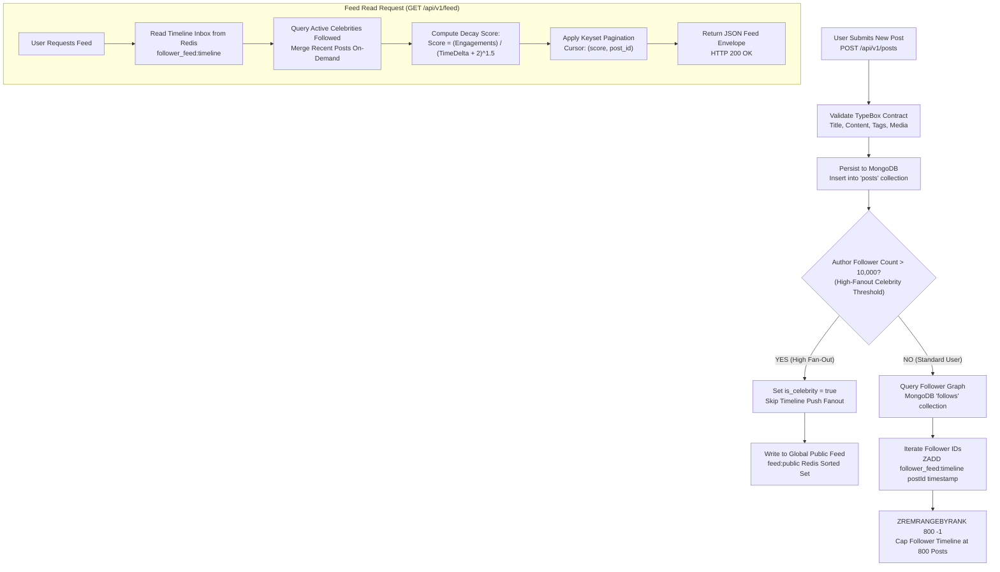
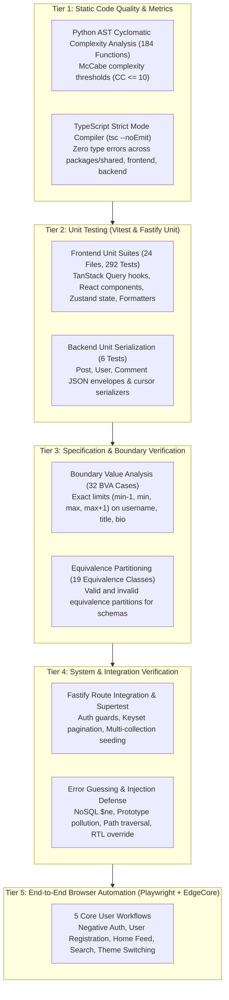
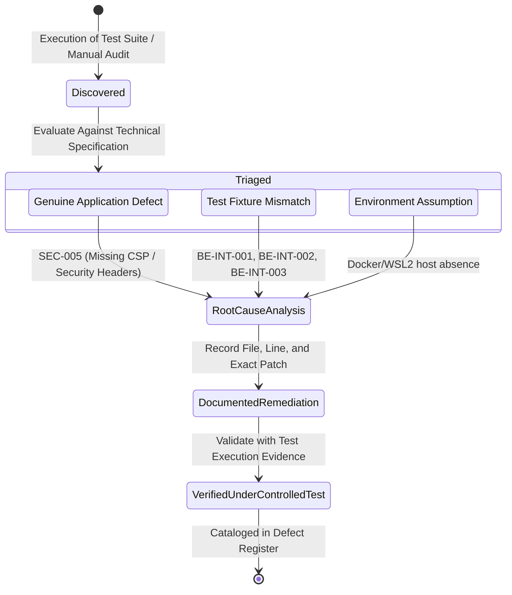

# SocialGraphandFeed System & Testing Architecture

This document formalizes the architectural topology, data flow patterns, feed distribution algorithms, and defect lifecycles of the SocialGraphandFeed platform for the QA verification baseline.

---

## 1. System Runtime & Network Topology

The platform executes across a decoupled three-tier topology consisting of a static asset proxy, a Fastify REST microservice, and a dual-datastore storage layer (MongoDB replica set and Redis in-memory cache).

```mermaid
flowchart TD
    subgraph ClientLayer["Client Layer (Port 3000 / Browser Viewport)"]
        Browser["React 18 SPA (Vite + TypeScript)<br/>TanStack Query + Zustand + TailwindCSS"]
    end

    subgraph ProxyLayer["Node.js Reverse Proxy & Static Host (Port 3000)"]
        ProxyServer["production-server.mjs<br/>Native HTTP Reverse Proxy"]
        StaticAssets["Static Bundle (/assets/*)<br/>packages/frontend/dist"]
    end

    subgraph ServiceLayer["API Microservice Layer (Port 4000)"]
        FastifyCore["Fastify v4 Core Engine<br/>packages/backend/src/app.ts"]
        AuthHook["Session / Cookie Auth PreHandler<br/>@fastify/cookie + @fastify/session"]
        TypeBoxValidator["AJV Schema Validation<br/>@sinclair/typebox Contracts"]
        RouteHandlers["Modular Route Handlers<br/>auth, users, posts, feed, graph, search"]
    end

    subgraph StorageLayer["Data & Cache Tier"]
        RedisCache[("Redis v8.10.1 (Port 6379)<br/>Feed Inboxes, Counters, Graph Cache")]
        MongoReplica[("MongoDB v7.0.14 rs0 (Port 27017)<br/>14 Seeded Collections (ACID Transactions)")]
    end

    Browser -->|"HTTP GET / (HTML/CSS/JS)"| ProxyServer
    ProxyServer -->|"Serve Static Files"| StaticAssets
    Browser -->|"HTTP /api/v1/* Requests"| ProxyServer
    ProxyServer -->|"Loopback Proxy (sub-5ms)"| FastifyCore
    FastifyCore --> AuthHook
    AuthHook --> TypeBoxValidator
    TypeBoxValidator --> RouteHandlers
    RouteHandlers -->|"In-Memory Cache (0.97ms)"| RedisCache
    RouteHandlers -->|"Persistent State (1.95ms)"| MongoReplica
```

---

## 2. Hybrid Feed Generation Pipeline (Meta TAO Pattern)

The feed distribution engine implements a hybrid push/pull fan-out architecture inspired by Meta's TAO social graph architecture. Ingestion behavior forks dynamically based on the author's follower degree.

---

## 3. QA Testing Pyramid & Multi-Layer Verification Architecture

The test execution suite spans five discrete verification tiers, ensuring comprehensive verification from static AST code metrics up to live browser workflow automation.

---

## 4. Defect Reconciliation & Resolution Lifecycle

The formal defect tracking lifecycle used during the QA verification audit ensures that test discrepancies are categorized accurately between genuine code bugs, environment configuration artifacts, and test fixture assumptions.

