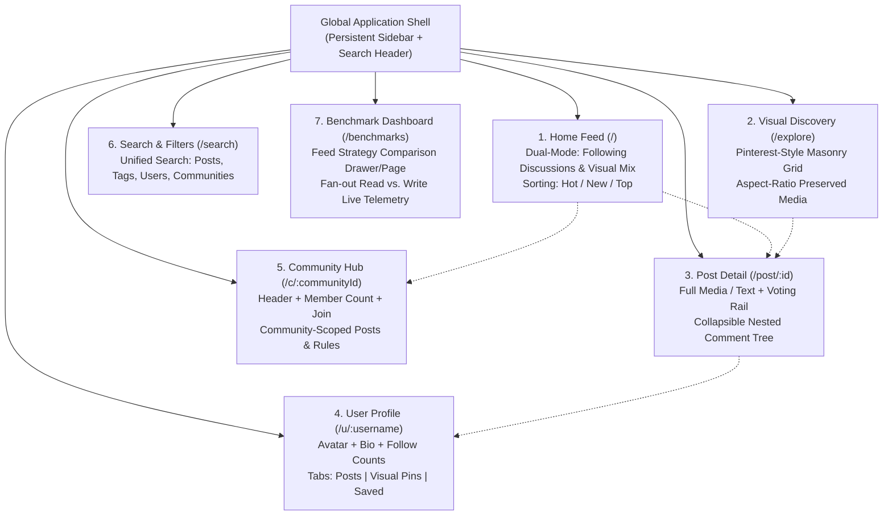

# Frontend Design Audit & Implementation Plan
## Social Graph & Feed Engineering Platform

**Document Status:** Complete Planning Deliverable (Audit & Architecture Proposal)  
**Author:** Pair Programming Assistant (Antigravity)  
**Audience:** Team Engineering Leads (Persons 1–4)  
**Constraint Scope:** 15-Day Delivery Schedule | Read-Only Audit Phase  

---

## 1. Repository Inventory

An inspection of the workspace root (`C:\Users\saram\Projects\SocialGraphandFeedEngineering`) was performed.

### Files and Directories Present
```
C:\Users\saram\Projects\SocialGraphandFeedEngineering\
├── instagram_DESIGN.md    (21,841 bytes) - Media-first social interface & layout analysis
├── meta_DESIGN.md         (37,986 bytes) - Hardware commerce & marketing design token system
├── pinterest_DESIGN.md    (36,392 bytes) - Masonry grid visual discovery design system
└── reddit_DESIGN.md       (23,474 bytes) - Community discussion, voting & nested comment system
```

### Confirmation of Initial State
- **No application code exists.** There is no `package.json`, build configuration (`vite.config.ts`, `next.config.js`), source code directory (`src/`), or component library.
- **No backend or database artifacts exist.** There are no MongoDB models, API routes, or Docker files.
- **No Git repository is initialized.** No `.git/` folder or branches are present.
- **Strict Adherence:** The four Markdown files serve strictly as design inputs and behavioural references. No files have been created, modified, or deleted in the workspace.

---

## 2. Four-File Design Audit & Comparative Analysis

Each design reference document was analyzed to extract actionable design principles, identify limitations and ambiguities, and evaluate suitability for our platform.

```
┌─────────────────────────────────────────────────────────────────────────────┐
│                       CROSS-BRAND DESIGN SYNTHESIS                          │
├─────────────────────┬──────────────────────┬────────────────────────────────┤
│ Source Reference    │ Core Strength        │ Integration Target             │
├─────────────────────┼──────────────────────┼────────────────────────────────┤
│ meta_DESIGN.md      │ Token Rigor & Scale  │ Token Schema, Button System    │
│ pinterest_DESIGN.md │ Visual Discovery     │ Masonry Grid, Aspect Ratios    │
│ instagram_DESIGN.md │ Media Social Card    │ Post Card Anatomy, Action Row  │
│ reddit_DESIGN.md    │ Community Discussion │ Voting Rail, Nested Threads    │
└─────────────────────┴──────────────────────┴────────────────────────────────┘
```

---

### 2.1 Meta Reference (`meta_DESIGN.md`)

#### Useful Principles
- **Disciplined Token Architecture:** Highly structured YAML frontmatter organizing tokens into `colors`, `typography`, `rounded`, `spacing`, and `components`.
- **4px / 8px Base Increment Spacing:** A predictable scale (`xxs: 4px`, `xs: 8px`, `sm: 10px`, `md: 12px`, `base: 16px`, `lg: 20px`, `xl: 24px`, `xxl: 32px`, `section: 64px`) providing consistent visual rhythm.
- **Two-Tier CTA Pattern:** Sharp functional differentiation between neutral dark buttons (`ink-button`) and high-salience action buttons (`primary` cobalt `#0064E0`).
- **Snug Typographic Setting:** Deliberate negative letter-spacing (`-0.14px` to `-0.16px` on body and buttons) to create compact, authoritative type.

#### Limitations & Ambiguities
- **Commerce-Specific Domain:** Built around Ray-Ban Meta AI and Quest 3S hardware sales, configurators, SKU pickers, warranty cards, and cart summaries rather than social graph interactions.
- **Promotional Surface Overkill:** Saturated yellow promo banners (`#f7b928`) and multi-column tech spec tables do not apply to feed rendering.

#### Retain / Adapt / Avoid Decisions
- **Retain:** The strict design token schema and the 4px/8px spacing rhythm.
- **Adapt:** The dual-CTA button model (neutral outlined ghost vs. solid brand action button).
- **Avoid:** E-commerce layouts, configurator sidebars, and hardware merchandising cards.

---

### 2.2 Pinterest Reference (`pinterest_DESIGN.md`)

#### Useful Principles
- **"Get Out of the Photograph's Way" Philosophy:** A warm-cream, neutral chrome (`#f6f6f3` surface-card, `#fbfbf9` soft surface, `#ffffff` canvas) that softly recedes behind user imagery.
- **Aspect Ratio-Preserving Masonry:** Column-based tiling where natural aspect ratios (1:1 square, 3:4 portrait, 2:3 tall, 16:9 landscape) are preserved with 8–16px gutters, eliminating awkward cropping.
- **Restrained Geometry:** A strict 3-tier border-radius scale (`16px` standard cards and buttons, `32px` feature cards, `9999px` pills and search bars).
- **Subtle Surface Pills:** Floating pills on imagery (`pin-overlay-pill`) for labels and tags without obscuring content.

#### Limitations & Ambiguities
- **Monochromatic Interactive Accent:** Pinterest Red (`#e60023`) is the single accent color. In discussion feeds, deep red is conventionally associated with errors, destructive actions, or downvotes.
- **No Discussion or Hierarchy Support:** The document lacks patterns for nested comment threads, community identity badges, or dual-direction voting.

#### Retain / Adapt / Avoid Decisions
- **Retain:** The responsive masonry grid algorithm, image aspect ratio preservation, 16px card radius, and floating overlay pills for the Visual Discovery view.
- **Adapt:** Warm-neutral background and surface tints (`#FAFAF9` and `#FFFFFF`), introducing a more modern neutral rather than heavy cream.
- **Avoid:** Pinterest Red as the universal CTA color across the entire platform.

---

### 2.3 Instagram Reference (`instagram_DESIGN.md`)

#### Useful Principles
- **Canonical Post Card Anatomy:** A robust, media-forward structure:
  $$\text{Header (Author + Time)} \longrightarrow \text{Media Box} \longrightarrow \text{Action Row (Like, Comment, Save)} \longrightarrow \text{Metrics \& Caption}$$
- **Restrained Media Chrome:** Minimalist borderlines (`1px solid #DBDBDB`) and edge-to-edge media cards.
- **Compact Interaction Targets:** 24px standardized icon glyphs set inside 40px hit targets; clear separation between leading actions (like/comment/share) and trailing actions (save/bookmark).
- **Profile Identity Conventions:** Circular avatars (`32px` in feed, `150px` in profile), follow/unfollow toggle buttons, and tabbed post collections.

#### Limitations & Ambiguities
- **Explicit Approximation Warnings:** The reference repeatedly notes that widths (`244px` sidebar, `470px` feed column), spacing, and colors (`#0095F6`, `#262626`) are approximate web implementation estimates, not official tokens.
- **Experimental Web State:** Meta frequently alters the web interface (e.g., 2025 Reels-first tests in India). The document warns against rigid adherence to any single layout variant.

#### Retain / Adapt / Avoid Decisions
- **Retain:** The feed post anatomy, circular avatar conventions, compact action-bar layout, and profile header structure.
- **Adapt:** Feed width constraints (allow up to 640px to comfortably accommodate discussion text alongside media).
- **Avoid:** Reels-specific vertical video carousels and multi-color story gradient rings.

---

### 2.4 Reddit Reference (`reddit_DESIGN.md`)

#### Useful Principles
- **Conversation-First & Community Organization:** Explicit hierarchy showcasing Community (`c/{name}`), Author (`u/{username}`), and relative timestamp at the post summit.
- **Bidirectional Voting System:** Distinct Upvote, Score Counter, and Downvote controls with persistent selected states and accessible labels.
- **Nested Comment Hierarchy:** Threaded discussion visualization using indentation guides, thread-collapsing click targets, and hierarchical reply actions.
- **Sorting Paradigm:** Global and community-specific feed sort controls (`Hot`, `New`, `Top`).
- **Dual Content Density Modes:** Ability to toggle between comfortable card view and compact list view.

#### Limitations & Ambiguities
- **Heavy Utilitarian Aesthetic:** The classic Reddit blue-gray canvas (`#DAE0E6`) and harsh borders create visual clutter when placed alongside modern visual discovery grids.
- **Trademark Restrictions:** The document explicitly warns against copying Reddit trademarks, Snoo iconography, or brand marks.

#### Retain / Adapt / Avoid Decisions
- **Retain:** The voting component, nested comment tree indentation with vertical connector lines, sort bars, and community metadata badges.
- **Adapt:** Lighten and modernize the card styling using clean white surfaces and subtle hairlines rather than heavy gray backdrops.
- **Avoid:** Snoo/Reddit branding and overly dense, text-only table layouts.

---

### 2.5 Audit Synthesis Matrix

| Design Dimension | Meta Reference | Pinterest Reference | Instagram Reference | Reddit Reference | Our Synthesis Direction |
| :--- | :--- | :--- | :--- | :--- | :--- |
| **Primary Accent** | Cobalt `#0064E0` | Crimson `#E60023` | Action Blue `#0095F6` | Orange-Red `#FF4500` | **Electric Indigo (`#2563EB`)** |
| **Secondary Accent** | Ink Black `#000000` | Cream Neutral `#F6F6F3`| Muted Gray `#737373` | Signal Orange `#FF4500` | **Ember Orange (`#F97316`)** for Upvotes |
| **Base Canvas** | White `#FFFFFF` | Warm Off-White `#FBFBF9`| Clean White `#FFFFFF` | Blue-Gray `#DAE0E6` | **Neutral Alabaster (`#FAFAF9`)** |
| **Corner Radius** | Full Pill (`100px`) | Dual (16px / 32px) | Mixed (0px / 8px) | Tight (4px / 8px) | **Tiered (8px / 12px / 16px / 9999px)** |
| **Core Typo** | Optimistic VF (300-700) | Pin Sans (400-700) | System Font Stack | Reddit Sans (400-700) | **Inter + Plus Jakarta Sans** |
| **Primary Surface** | Product Photography | Masonry Pin Grid | Single-Column Media | Threaded Discussions | **Dual-Mode Graph: Masonry + Threaded Cards** |

---

## 3. Unified Visual Identity Proposal

To avoid looking like disparate components pasted together, our platform establishes a unified design system that fuses high-impact visual discovery with structured community discourse.

### 3.1 Proposed Brand Names
1. **PulseGraph** *(Recommended)*: Directly evokes real-time social graph connections, feed fan-out pulses, and system throughput telemetry.
2. **NexusFeed**: Highlights the convergence of visual discovery, community discussion, and feed engineering.
3. **Khoros**: Derived from the Greek term for coordinated ensemble movement, symbolizing graph nodes operating in synchrony.

---

### 3.2 Design Token System

#### Color Palette
```css
:root {
  /* Brand Accents */
  --color-brand-primary: #2563EB;       /* Electric Indigo: Primary actions, active navigation */
  --color-brand-primary-hover: #1D4ED8; /* Pressed/hover state */
  --color-brand-primary-soft: #EFF6FF;  /* Light tint for selected filters and active tabs */
  
  --color-brand-secondary: #F97316;     /* Ember Orange: Upvotes, hot community badges */
  --color-brand-secondary-hover: #EA580C;
  --color-brand-downvote: #6366F1;      /* Periwinkle Indigo: Downvotes (avoids harsh red) */

  /* Neutral Surfaces (Light Theme) */
  --color-canvas: #FAFAF9;              /* Warm Alabaster page canvas */
  --color-surface-card: #FFFFFF;        /* Clean card and tile surface */
  --color-surface-subtle: #F4F4F5;      /* Inputs, secondary buttons, vote pill track */
  --color-surface-elevated: #FFFFFF;    /* Modals, popovers, dropdowns */

  /* Text & Hierarchy */
  --color-text-primary: #0F172A;        /* Slate 900: Headlines, titles, active labels */
  --color-text-secondary: #475569;      /* Slate 600: Body copy, comments */
  --color-text-muted: #94A3B8;          /* Slate 400: Timestamps, secondary metadata */
  --color-text-on-brand: #FFFFFF;       /* Pure white on primary fills */

  /* Hairlines & Dividers */
  --color-border: #E2E8F0;              /* Hairline card borders, table dividers */
  --color-border-subtle: #F1F5F9;       /* Light comment nesting guide rails */
  --color-border-focus: #2563EB;        /* Accessible keyboard focus ring */

  /* System Semantics */
  --color-success: #10B981;             /* Cache hit indicator, benchmark success */
  --color-warning: #F59E0B;             /* Stale cache indicator, warning toast */
  --color-danger: #EF4444;              /* Error boundary, destructive confirmation */
  --color-info: #0284C7;                /* System telemetry pill */
}
```

```css
/* Dark Theme Variant */
[data-theme="dark"] {
  --color-canvas: #09090B;              /* Zinc 950 deep canvas */
  --color-surface-card: #18181B;        /* Zinc 900 surface */
  --color-surface-subtle: #27272A;      /* Zinc 800 inputs and vote rails */
  --color-surface-elevated: #27272A;
  
  --color-text-primary: #F8FAFC;
  --color-text-secondary: #CBD5E1;
  --color-text-muted: #64748B;
  
  --color-border: #27272A;
  --color-border-subtle: #1F2937;
}
```

---

#### Typography System
- **Primary Typeface:** `Inter`, with fallbacks `-apple-system, BlinkMacSystemFont, "Segoe UI", Roboto, sans-serif`.
- **Display / Brand Headline:** `Plus Jakarta Sans` (weights 600, 700) for hero titles and community names.
- **Benchmark / Telemetry Mono:** `JetBrains Mono, "Fira Code", monospace` for latency numbers, cache hits/misses, and algorithmic strategy indicators.

| Typographic Role | Size | Weight | Line Height | Letter Spacing | Target Application |
| :--- | :--- | :--- | :--- | :--- | :--- |
| `display-lg` | 32px | 700 | 1.20 | -0.02em | Hero headers, Profile names |
| `heading-md` | 24px | 600 | 1.25 | -0.015em | Community headers, Page titles |
| `heading-sm` | 18px | 600 | 1.30 | -0.01em | Discussion post titles |
| `subtitle` | 15px | 600 | 1.40 | 0 | Card section labels, Modal titles |
| `body-base` | 15px | 400 | 1.50 | 0 | Post text, Comment thread prose |
| `body-sm` | 13px | 400 | 1.45 | 0 | Metadata, timestamps, helper text |
| `caption` | 12px | 600 | 1.30 | +0.01em | Overlay pills, Category chips, Badges |
| `telemetry-mono` | 12px | 500 | 1.40 | 0 | Latency metrics (`p95: 14ms`), Cache tags |

---

#### Geometry & Spacing
- **Base Grid:** 4px with 8px primary steps (`4px`, `8px`, `12px`, `16px`, `24px`, `32px`, `48px`, `64px`).
- **Corner Radii:**
  - `rounded-sm (6px):` Badges, telemetry tags, dropdown items.
  - `rounded-md (10px):` Form controls, buttons, voting tracks.
  - `rounded-lg (14px):` Discussion cards, community banners, modal sheets.
  - `rounded-xl (18px):` Masonry visual pins (inspired by Pinterest's 16px card radius).
  - `rounded-full (9999px):` Search bar, category filter chips, circular avatars, overlay pills.
- **Elevation & Shadows:**
  - Standard cards are predominantly flat with a crisp `1px solid var(--color-border)`.
  - Subtle interactive lift on hover: `box-shadow: 0 4px 12px -2px rgba(0, 0, 0, 0.06)`.
  - Floating overlays: `box-shadow: 0 10px 25px -5px rgba(0, 0, 0, 0.12)`.

---

### 3.3 Card System: Visual vs. Discussion Synthesis

To unite Pinterest-style visual discovery and Reddit-style community discussions into one product, we introduce two specialized card layouts derived from the same underlying post data model:

```
┌─────────────────────────────────┐     ┌────────────────────────────────────────────────────────┐
│      VISUAL DISCOVERY CARD      │     │                 DISCUSSION FEED CARD                   │
├─────────────────────────────────┤     ├──────┬─────────────────────────────────────────────────┤
│ ┌─────────────────────────────┐ │     │      │ c/distributed-systems • u/alec • 2h ago         │
│ │                             │ │     │  ▲   │ [Fan-out Read] [Cache Hit]                      │
│ │      Natural Aspect         │ │     │      │                                                 │
│ │      Media Box              │ │     │ 142  │ Why TAO separates cache consistency from write  │
│ │      (1:1, 4:5, 3:4)        │ │     │      │ invalidation at scale                           │
│ │                             │ │     │  ▼   │                                                 │
│ │ ┌─────────────┐             │ │     │      │ In Meta's architecture, write invalidation...   │
│ │ │ #SystemArch │             │ │     │      ├─────────────────────────────────────────────────┤
│ └─┴─────────────┴─────────────┘ │     │      │ 💬 38 comments   ↗ Share   🔖 Save               │
│ u/sara • 428 ❤️ • 💬 19        │     └──────┴─────────────────────────────────────────────────┘
└─────────────────────────────────┘
```

1. **Visual Discovery Card (`MasonryPinCard`):**
   - Media-first with zero internal card padding around the image.
   - Natural aspect ratios preserved with dimensions reserved to eliminate Cumulative Layout Shift (CLS).
   - Bottom overlay pill for tags/creator attribution.
   - Lightweight hover action trigger (Save, Like, Quick-View).
2. **Discussion Feed Card (`DiscussionPostCard`):**
   - Left-aligned voting rail (`▲ Score ▼`) or horizontal compact vote pill on mobile.
   - Header with Community pill (`c/{name}`), Author (`u/{name}`), relative timestamp, and an optional **Feed Strategy Badge** (`Fan-out on Read` vs. `Fan-out on Write`).
   - Content block with high-readability typography, supporting optional media embeds or external link previews.
   - Action footer for nested comments count, share, and bookmark.

---

## 4. Proposed Product Screens & Page Map

The frontend experience provides two distinct lenses on the same underlying social graph, accompanied by an engineering-grade benchmark view.



---

### Priority 1: Home Feed (`/` or `/feed`)
- **Core Purpose:** The central landing surface displaying posts from followed users and joined communities.
- **Must-Have Features:**
  - View switcher: Toggle between **Discussion Mode** (Reddit-style cards) and **Media Stream** (Instagram-style rich cards).
  - Sort selector: `Hot` (ranking score), `New` (chronological), and `Top` (highest vote count).
  - Feed generation strategy indicator: Displays whether the current feed batch was delivered via Fan-out on Read or Fan-out on Write, including latency micro-metrics.
  - Infinite scroll with cursor-based pagination and skeleton loading placeholders.
- **Acceptance Criteria:**
  - Initial load renders feed items in $<1.5$ seconds using cached or pre-fetched data.
  - Sorting switch updates feed without full page refresh.
  - Unauthenticated or empty state displays a "Welcome to PulseGraph — Follow creators or join communities" prompt with starter suggestions.

---

### Priority 2: Visual Discovery (`/explore` or `/discovery`)
- **Core Purpose:** High-engagement visual exploration inspired by Pinterest's masonry grid.
- **Must-Have Features:**
  - Multi-column responsive masonry layout (2 columns on mobile, 3 on tablet, 4–5 on wide desktop).
  - Aspect ratio preservation: Media boxes calculate height prior to image download using metadata ratios (`width/height`), eliminating layout shift.
  - Category pill filter strip at top: `Architecture`, `Systems`, `Visuals`, `Algorithms`, `Hardware`.
  - One-click modal preview or seamless transition into Post Detail.
- **Acceptance Criteria:**
  - Columns fill dynamically without horizontal gaps.
  - Zero Cumulative Layout Shift (CLS score $<0.05$).
  - Images lazy-load using native `loading="lazy"` and blur-up placeholder backgrounds.

---

### Priority 3: Post Detail & Nested Comments (`/post/:postId`)
- **Core Purpose:** Focused engagement view for deep discussion and media consumption.
- **Must-Have Features:**
  - Comprehensive post header with community context, creator attribution, follow action, and timestamps.
  - Two-level or unlimited nested comment tree with left indentation and vertical clickable guide lines to collapse sub-threads.
  - Comment composer with markdown preview or rich text formatting.
  - Real-time vote increment with optimistic UI update and error rollback.
- **Acceptance Criteria:**
  - Clicking any vertical guide line collapses all children under that comment node.
  - Submitting a reply immediately renders into the tree optimistically.
  - Deep nesting ($>4$ levels) gracefully caps indentation on mobile viewports to prevent narrow text squeezing.

---

### Priority 4: User Profile (`/u/:username`)
- **Core Purpose:** Identity and relationship hub.
- **Must-Have Features:**
  - Profile header: Large avatar, username, handle, bio, follower count, following count.
  - Follow / Unfollow primary action button with instant optimistic feedback.
  - Tabbed post collections: `Discussions`, `Visual Pins`, and `Saved Posts`.
  - Follower / Following modal list.
- **Acceptance Criteria:**
  - Own profile displays "Edit Profile" (or simulated profile switcher); other profiles display "Follow" / "Following".
  - Switching tabs filters the user's content without reloading the header.

---

### Priority 5: Community Hub (`/c/:communityId`)
- **Core Purpose:** Dedicated space for topical discussions and community-specific feeds.
- **Must-Have Features:**
  - Community banner and badge with `Join Community` / `Joined` toggle.
  - Community metadata sidebar: Subscriber count, active members, community rules.
  - Feed sort bar scoped specifically to that community.
- **Acceptance Criteria:**
  - Joining a community immediately updates the member count and persists state.
  - Community feed respects scoped sorting.

---

### Priority 6: Search & Discovery (`/search`)
- **Core Purpose:** Finding posts, tags, users, and communities.
- **Recommended Implementation:** A dual-purpose search component — an inline auto-suggest popover in the top navigation bar for quick searches, navigating to a full `/search?q={query}` results page with tabbed filters (`All`, `Posts`, `Communities`, `People`).

---

### Priority 7 (Engineering Feature): Feed Strategy & Benchmark Inspector (`/benchmarks` or Drawer)
- **Evaluation & Recommendation:** **Include as a lightweight Benchmark Drawer & Route.**
- **Rationale:** This platform is specifically built to demonstrate Meta TAO-inspired feed serving challenges (fan-out on read vs. fan-out on write, MongoDB indexing, and caching). A dedicated UI panel that displays real live metrics from Person 1 and 2's backend elevates this from a conventional student project to an impressive engineering demo.
- **Scope-Controlled Implementation:**
  - Toggle between **Strategy A (Fan-Out on Read)** and **Strategy B (Fan-Out on Write)**.
  - Live metric display cards: `Feed Fetch Latency (ms)`, `Database Document Reads`, `Cache Hit / Miss Ratio`, `Follower Fan-Out Count`.
  - Latency comparison bar chart demonstrating write cost vs. read cost under simulated high-follower load.

---

## 5. Component Hierarchy & Design System Plan

A component architecture designed for clean separation between presentation, interaction state, and API communication.

```
src/
├── components/
│   ├── ui/                         # Atomic Design System Primitives
│   │   ├── Button.tsx              # Primary, secondary, ghost, pill variants
│   │   ├── IconButton.tsx          # 24px icon with 40px hit target
│   │   ├── Input.tsx               # Text input with double-ring focus
│   │   ├── SearchBar.tsx           # Pill-shaped search bar with clear button
│   │   ├── Avatar.tsx              # Circular avatar with fallback initials
│   │   ├── Badge.tsx               # Status badges, telemetry chips
│   │   ├── Pill.tsx                # Filter chips, active state toggles
│   │   ├── VoteControl.tsx         # Upvote / Score / Downvote atomic unit
│   │   ├── Modal.tsx               # Accessible dialog with backdrop scrim
│   │   ├── Skeleton.tsx            # Pulse placeholders for cards and text
│   │   └── Toast.tsx               # Ephemeral feedback alerts
│   │
│   ├── layout/                     # Application Shell Components
│   │   ├── AppLayout.tsx           # Outer frame with responsive sidebar
│   │   ├── SidebarNav.tsx          # Desktop left navigation
│   │   ├── TopHeader.tsx           # Global search and user quick-actions
│   │   ├── MobileBottomNav.tsx     # Mobile bottom icon bar
│   │   └── RightRail.tsx           # Context rail (trending, community rules)
│   │
│   ├── feed/                       # Feed & Social Graph Presentation
│   │   ├── FeedList.tsx            # Virtualized/infinite scroll container
│   │   ├── FeedSortBar.tsx         # Hot / New / Top / Strategy switcher
│   │   ├── DiscussionPostCard.tsx  # Reddit-style discussion card
│   │   ├── MasonryGrid.tsx         # Multi-column Pinterest-style layout
│   │   ├── MasonryPinCard.tsx      # Media-forward visual card
│   │   ├── MediaViewer.tsx         # Aspect-ratio preserved image viewer
│   │   ├── PostActionsBar.tsx      # Like, comment, share, bookmark row
│   │   └── CreatePostDialog.tsx    # Modal dialog for publishing posts
│   │
│   ├── comments/                   # Threaded Discussion Components
│   │   ├── CommentTree.tsx         # Recursive comment hierarchy renderer
│   │   ├── CommentItem.tsx         # Single comment with collapse line
│   │   └── CommentComposer.tsx     # Reply / post comment input form
│   │
│   ├── community/                  # Community & Profile Primitives
│   │   ├── CommunityHeader.tsx     # Banner, avatar, join button
│   │   ├── CommunityRulesCard.tsx  # Sidebar guidelines widget
│   │   ├── ProfileHeader.tsx       # Bio, stats, follow toggle
│   │   └── FollowButton.tsx        # Optimistic follow/unfollow controller
│   │
│   └── benchmark/                  # Engineering Telemetry Widgets
│       ├── BenchmarkDrawer.tsx     # Sliding drawer with live telemetry
│       ├── MetricCard.tsx          # Latency / cache stat display
│       └── StrategyComparison.tsx  # Fan-out on Read vs. Write chart
```

---

## 6. Frontend Architecture Proposal

### 6.1 Recommended Tech Stack

| Layer | Recommended Choice | Rationale & Trade-offs |
| :--- | :--- | :--- |
| **Framework** | **React 19 + Vite** | Instant cold start, $<50\text{ms}$ Hot Module Replacement (HMR). Avoids Next.js SSR server configuration and hydration mismatches during a rapid 15-day sprint. |
| **Language** | **TypeScript (Strict)** | Strict compile-time validation ensures data shapes match the backend contract precisely. |
| **Styling** | **Tailwind CSS v3/v4** | Rapid utility-first styling; custom theme directly maps our design tokens (`colors`, `spacing`, `radii`). |
| **Icons** | **Lucide React** | Consistent 24px stroke-based icons matching Instagram and Reddit conventions with zero bloat. |
| **Routing** | **React Router v6 / v7** | Standard client-side routing with URL query param synchronisation for sorting and search. |
| **Data Fetching** | **TanStack Query (v5)** | Essential for feeds: built-in `useInfiniteQuery`, cursor pagination, optimistic updates, and cache invalidation. |
| **Masonry Engine** | **CSS Columns + Flex Resize Observer** | A lightweight custom hook calculates column count without heavy external dependencies. |

---

### 6.2 Proposed Directory Structure
```
frontend/
├── public/
│   └── favicon.svg
├── src/
│   ├── api/                        # API Client & Adapters
│   │   ├── client.ts               # Axios or Fetch wrapper with interceptors
│   │   ├── feedApi.ts              # Feed endpoints
│   │   ├── postApi.ts              # Post, comment, and vote endpoints
│   │   ├── userApi.ts              # Profile and follow endpoints
│   │   ├── communityApi.ts         # Community endpoints
│   │   ├── benchmarkApi.ts         # Strategy telemetry endpoints
│   │   └── mock/                   # Mock adapter layer for offline dev
│   │       ├── mockData.ts         # Realistic pre-generated data
│   │       └── mockAdapter.ts      # Switchable mock toggle
│   ├── components/                 # Components categorized above
│   ├── hooks/                      # Custom React Hooks
│   │   ├── useFeed.ts              # Infinite query feed hook
│   │   ├── useVote.ts              # Optimistic vote hook
│   │   ├── useFollow.ts            # Optimistic follow hook
│   │   └── useMasonry.ts           # Dynamic column calculator
│   ├── pages/                      # Page Level Views
│   │   ├── HomePage.tsx
│   │   ├── DiscoveryPage.tsx
│   │   ├── PostDetailPage.tsx
│   │   ├── ProfilePage.tsx
│   │   ├── CommunityPage.tsx
│   │   ├── SearchPage.tsx
│   │   └── BenchmarkPage.tsx
│   ├── types/                      # TypeScript Contracts
│   │   ├── api.ts                  # Cursor pagination, response wrappers
│   │   ├── post.ts                 # Post, media, and vote types
│   │   ├── comment.ts              # Nested comment tree types
│   │   ├── user.ts                 # User profile and social graph types
│   │   ├── community.ts            # Community types
│   │   └── benchmark.ts            # Telemetry types
│   ├── styles/
│   │   └── index.css               # Tailwind imports & CSS custom properties
│   ├── App.tsx                     # Route definitions & providers
│   └── main.tsx                    # React DOM root entrypoint
├── index.html
├── package.json
├── tsconfig.json
├── tailwind.config.js
└── vite.config.ts
```

---

## 7. Backend Integration Contract (API Proposal)

This API contract is a proposal for review by the backend engineering leads (Persons 1 and 2). It provides consistent cursor-based pagination, typed responses, and telemetry metadata.

### 7.1 Global Architectural Conventions
- **Base URL:** `/api/v1`
- **Cursor Pagination:** Standardized across all collection endpoints to prevent offset-based page degradation on high-velocity social feeds.
- **Authentication:** Simulated Bearer token or test header `X-User-Id: user_123` during development, making multi-user testing straightforward.

---

### 7.2 Standard Response Wrapper
```typescript
interface ApiResponse<T> {
  success: boolean;
  data: T;
  meta?: {
    latency_ms: number;
    served_by_strategy?: "fanout_on_read" | "fanout_on_write";
    cache_status?: "HIT" | "MISS" | "STALE";
  };
}

interface PaginatedResponse<T> extends ApiResponse<T[]> {
  next_cursor: string | null;
  has_more: boolean;
}
```

---

### 7.3 Proposed Endpoints

#### 1. Home Feed
- **Method / Path:** `GET /api/v1/feed`
- **Query Parameters:**
  - `strategy`: `"fanout_on_read"` | `"fanout_on_write"` (default: backend default)
  - `sort`: `"hot"` | `"new"` | `"top"`
  - `cursor`: `string` (optional, ID/timestamp cursor)
  - `limit`: `number` (default: 20)
- **Response Shape:**
```json
{
  "success": true,
  "data": [
    {
      "id": "post_101",
      "author": {
        "id": "usr_42",
        "username": "linus_t",
        "avatar_url": "https://images.unsplash.com/photo-1534528741775-53994a69daeb?w=100",
        "is_following": true
      },
      "community": {
        "id": "c_systems",
        "name": "systems",
        "display_name": "Distributed Systems"
      },
      "title": "Benchmarking TAO Write Invalidation Latency",
      "content": "We simulated 10k follower fan-out writes against our replica cache cluster...",
      "post_type": "discussion",
      "media_urls": [],
      "aspect_ratio": null,
      "score": 384,
      "user_vote": 1,
      "comment_count": 47,
      "created_at": "2026-10-14T00:30:00Z"
    }
  ],
  "next_cursor": "post_101_cursor_token",
  "has_more": true,
  "meta": {
    "latency_ms": 18.4,
    "served_by_strategy": "fanout_on_write",
    "cache_status": "HIT"
  }
}
```

---

#### 2. Visual Discovery Feed
- **Method / Path:** `GET /api/v1/discovery`
- **Query Parameters:**
  - `category`: `string` (optional, e.g. `"architecture"`, `"hardware"`)
  - `cursor`: `string` (optional)
  - `limit`: `number` (default: 24)
- **Response Shape:**
```json
{
  "success": true,
  "data": [
    {
      "id": "pin_204",
      "author": {
        "id": "usr_88",
        "username": "elena_arch",
        "avatar_url": "https://images.unsplash.com/photo-1494790108377-be9c29b29330?w=100"
      },
      "title": "Server Rack Fluid Immersion Cooling Setup",
      "image_url": "https://images.unsplash.com/photo-1558494949-ef010cbdcc31?w=800",
      "aspect_ratio": 1.333,
      "tags": ["Hardware", "Datacenter"],
      "like_count": 892,
      "is_liked": false,
      "created_at": "2026-10-13T22:15:00Z"
    }
  ],
  "next_cursor": "pin_204_cursor",
  "has_more": true
}
```

---

#### 3. Post Detail & Threaded Comments
- **Method / Path:** `GET /api/v1/posts/:postId`
  - Returns the full post entity with author, media, and engagement counters.
- **Method / Path:** `GET /api/v1/posts/:postId/comments`
- **Query Parameters:** `sort`: `"top"` | `"new"` | `"old"`
- **Response Shape (Recursive Tree Structure):**
```json
{
  "success": true,
  "data": [
    {
      "id": "cmt_501",
      "post_id": "post_101",
      "parent_id": null,
      "author": {
        "id": "usr_99",
        "username": "dist_coder",
        "avatar_url": "https://images.unsplash.com/photo-1507003211169-0a1dd7228f2d?w=100"
      },
      "body": "Did you measure the P99 replication lag when invalidating caches?",
      "score": 24,
      "user_vote": 0,
      "created_at": "2026-10-14T00:45:00Z",
      "replies": [
        {
          "id": "cmt_502",
          "post_id": "post_101",
          "parent_id": "cmt_501",
          "author": {
            "id": "usr_42",
            "username": "linus_t",
            "avatar_url": "https://images.unsplash.com/photo-1534528741775-53994a69daeb?w=100"
          },
          "body": "Yes! The P99 was 42ms on the replica nodes under 5,000 req/sec load.",
          "score": 12,
          "user_vote": 1,
          "created_at": "2026-10-14T00:52:00Z",
          "replies": []
        }
      ]
    }
  ]
}
```

---

#### 4. Interaction Mutations
- **Vote on Post:** `POST /api/v1/posts/:postId/vote`
  - **Body:** `{ "direction": 1 | -1 | 0 }` (1: Upvote, -1: Downvote, 0: Clear)
  - **Response:** `{ "success": true, "new_score": 385, "user_vote": 1 }`
- **Submit Comment:** `POST /api/v1/posts/:postId/comments`
  - **Body:** `{ "body": "...", "parent_id": "cmt_501" | null }`
  - **Response:** Complete created `Comment` object.
- **Publish Post:** `POST /api/v1/posts`
  - **Body:**
```json
{
  "title": "New Benchmarks Available",
  "content": "Detailed analysis of MongoDB sharded indexes...",
  "post_type": "discussion",
  "community_id": "c_systems",
  "media_urls": []
}
```

---

#### 5. Social Graph Endpoints
- **Get User Profile:** `GET /api/v1/users/:username`
  - **Response:**
```json
{
  "success": true,
  "data": {
    "id": "usr_42",
    "username": "linus_t",
    "display_name": "Linus Torvalds",
    "bio": "Systems engineer & kernel hacker. Working on feed caching algorithms.",
    "avatar_url": "https://images.unsplash.com/photo-1534528741775-53994a69daeb?w=200",
    "follower_count": 14200,
    "following_count": 86,
    "posts_count": 312,
    "is_following": true
  }
}
```
- **Follow User:** `POST /api/v1/users/:userId/follow`
- **Unfollow User:** `DELETE /api/v1/users/:userId/follow`

---

#### 6. Engineering Benchmark Telemetry
- **Method / Path:** `GET /api/v1/benchmarks/metrics`
- **Response Shape:**
```json
{
  "success": true,
  "data": {
    "fanout_on_read": {
      "avg_latency_ms": 68.4,
      "p95_latency_ms": 142.1,
      "write_cost_ops": 1.0,
      "read_cost_ops": 250.0,
      "cache_hit_rate": 0.42
    },
    "fanout_on_write": {
      "avg_latency_ms": 12.1,
      "p95_latency_ms": 28.5,
      "write_cost_ops": 250.0,
      "read_cost_ops": 1.0,
      "cache_hit_rate": 0.94
    },
    "popular_account_test": {
      "follower_count": 50000,
      "fanout_write_duration_ms": 320.0,
      "queued_jobs": 12
    }
  }
}
```

---

## 8. Fifteen-Day Implementation Plan

A milestone schedule tailored to a 15-day sprint, designed to proceed in parallel with the backend team.

```mermaid
gantt
    title 15-Day Engineering & Frontend Milestones
    dateFormat  D
    axisFormat Day %d
    
    section Milestone 1: Foundations
    Scaffold & Design Tokens      :m1_1, 1, 2d
    Atomic UI Primitives          :m1_2, after m1_1, 1d
    Mock Adapter Layer            :m1_3, after m1_1, 2d
    
    section Milestone 2: Core Feeds
    Masonry Discovery Feed        :m2_1, 4, 2d
    Discussion Home Feed          :m2_2, 5, 2d
    Post Detail & Comment Tree    :m2_3, 6, 2d
    
    section Milestone 3: Social Graph
    User Profile & Follow Toggle  :m3_1, 8, 2d
    Community Hub & Search        :m3_2, 9, 2d
    
    section Milestone 4: Backend Integration
    Real API Wire-up              :m4_1, 11, 2d
    Error Boundaries & State Sync :m4_2, 12, 1d
    
    section Milestone 5: Benchmarks & Polish
    Benchmark Telemetry UI        :m5_1, 13, 1d
    Performance, CLS & Docker     :m5_2, 14, 2d
```



---

### Milestone 1: Project Scaffold, Design Tokens & Mock Foundation (Days 1–3)
- **Frontend Deliverables:**
  - Initialize Vite React 19 + TypeScript + Tailwind CSS project.
  - Implement full design token set in `tailwind.config.js` and `index.css`.
  - Build atomic UI primitives (`Button`, `Input`, `Avatar`, `Badge`, `Pill`, `VoteControl`, `Modal`, `Skeleton`).
  - Set up Mock API Layer with realistic pre-generated data so UI development proceeds without blocking on backend availability.
- **Backend Sync Point:** Review and freeze API contract (Section 7) with Persons 1 and 2.
- **Exit Criteria:** Interactive story/sandbox demonstrating all atomic components in both light and dark modes.

---

### Milestone 2: Core Feeds & Post Detail (Days 4–7)
- **Frontend Deliverables:**
  - Build `MasonryGrid` and `MasonryPinCard` preserving natural aspect ratios (Pinterest reference).
  - Build `DiscussionPostCard` with community header, title, and voting control (Reddit reference).
  - Implement Home Feed view switcher (`Discussion Mode` vs. `Visual Mode`) with `Hot` / `New` / `Top` sorting.
  - Build `PostDetailPage` with collapsible threaded `CommentTree` and reply composer.
- **Backend Sync Point:** Backend team provides initial draft endpoints for `/feed` and `/posts`.
- **Exit Criteria:** User can scroll feeds, toggle sort orders, open any post, upvote/downvote, and collapse comment threads using mock data.

---

### Milestone 3: Social Graph & Community Hubs (Days 8–10)
- **Frontend Deliverables:**
  - Implement `ProfilePage` (`/u/:username`) with follower/following stats and optimistic `FollowButton`.
  - Implement `CommunityPage` (`/c/:communityId`) with community header, rules sidebar, and join toggle.
  - Implement `CreatePostDialog` supporting both text discussions and visual image submissions.
  - Add search bar with debounce popover suggestions.
- **Backend Sync Point:** Backend team implements follow edge mutations and MongoDB indexes.
- **Exit Criteria:** Social graph transitions (follow/unfollow, join/leave) persist across client views with optimistic feedback.

---

### Milestone 4: Live Backend Integration & Error Handling (Days 11–12)
- **Frontend Deliverables:**
  - Replace mock adapter with live API client pointing to backend service.
  - Implement error boundaries, offline retry states, and optimistic mutation rollback on network failure.
  - Validate cursor pagination under high-volume data sets provided by Person 2's benchmark scripts.
- **Backend Sync Point:** Combined integration testing with live MongoDB and Redis caching layer.
- **Exit Criteria:** Real backend serves feeds; voting, creating posts, and following users updates the live database.

---

### Milestone 5: Benchmark Dashboard, Polish & Containerization (Days 13–15)
- **Frontend Deliverables:**
  - Build the **Feed Strategy & Benchmark Dashboard** (`/benchmarks` or Drawer) displaying live latency comparisons between Fan-out on Read and Fan-out on Write.
  - Prevent Cumulative Layout Shift (CLS) on all image loads using intrinsic aspect ratios.
  - Add production Dockerfile with multi-stage build (`nginx` static serving) and CI/CD verification.
  - Perform cross-browser testing across mobile (390px), tablet (768px), and desktop (1440px).
- **Backend Sync Point:** Run demo script: publish post from a high-follower account and observe live fan-out telemetry.
- **Exit Criteria:** The complete application is containerized, runs with a single `docker compose up`, and delivers a smooth presentation-ready demo.

---

## 9. Observable Acceptance Criteria for Major Screens

### Screen 1: Home Feed (`/`)
- [ ] Renders top navigation bar with search, brand mark, and user avatar.
- [ ] Sort bar allows switching between `Hot`, `New`, and `Top`, updating the post list.
- [ ] Strategy badge indicates which feed-generation algorithm served the batch.
- [ ] Infinite scrolling triggers subsequent cursor fetch when scrolling within 400px of the bottom.
- [ ] Empty state displays recommended creators and communities when following list is empty.

### Screen 2: Visual Discovery (`/explore`)
- [ ] Masonry grid smoothly distributes pins across columns based on viewport width (2 col $<640\text{px}$, 3 col $<1024\text{px}$, 4–5 col $\ge 1024\text{px}$).
- [ ] Images retain natural aspect ratios without horizontal stretching or container overflow.
- [ ] Layout shift score remains below 0.05 during image loading.
- [ ] Category filter pills toggle active state and re-filter the visual feed.
- [ ] Clicking a pin opens post detail or focused modal.

### Screen 3: Post Detail & Comments (`/post/:postId`)
- [ ] Renders full post with voting rail, author metadata, community badge, and timestamp.
- [ ] Comment thread renders hierarchical replies with vertical guide lines connecting parents to children.
- [ ] Clicking a comment's vertical guide line collapses that entire sub-tree and shows a "collapsed (+N replies)" label.
- [ ] Submitting a reply appends the comment immediately (optimistic UI) before backend confirmation.
- [ ] Upvote and downvote buttons toggle color and update the displayed score without page jump.

### Screen 4: User Profile (`/u/:username`)
- [ ] Displays avatar, bio, follower count, and following count.
- [ ] Follow button updates from "Follow" to "Following" on click, with immediate optimistic count increment.
- [ ] Tab navigation switches smoothly between `Discussions`, `Visual Pins`, and `Saved`.
- [ ] Private or not-found profiles display a user-friendly fallback state.

### Screen 5: Community Hub (`/c/:communityId`)
- [ ] Displays community banner, description, and member count.
- [ ] "Join" button toggles membership state and updates member count.
- [ ] Feed is strictly filtered to posts belonging to that community.
- [ ] Right sidebar displays community rules and moderator list on desktop screens.

### Screen 6: Benchmark & Feed Strategy Dashboard (`/benchmarks`)
- [ ] Side-by-side comparison cards display Fan-out on Read vs. Fan-out on Write metrics.
- [ ] Shows live response time (ms), database reads, and cache hit ratio.
- [ ] Includes interactive control to switch active feed strategy and measure response time delta.

---

## 10. Risks, Scope Reductions & Contingency Plans

To guarantee completion within the strict 15-day timeline, features are categorized into Must-Have, Should-Have, and Explicitly Deferred.

```
┌─────────────────────────────────────────────────────────────────────────────┐
│                            SCOPE CONTROL MATRIX                             │
├──────────────────────┬──────────────────────┬───────────────────────────────┤
│ Core (Must-Have)     │ Should-Have          │ Explicitly Deferred           │
├──────────────────────┼──────────────────────┼───────────────────────────────┤
│ Visual Masonry Grid  │ Benchmark Drawer     │ Real-time WebSockets / Chat   │
│ Discussion Post Feed │ Dark Mode Switcher   │ Complex Image Upload / Crop   │
│ Voting & Comments    │ Dynamic Search Popover│ OAuth2 / Social Logins       │
│ Profiles & Following │ Category Pills       │ Video Streaming / Reels       │
│ Cursor Pagination    │ Compact View Mode    │ Push Notification Service     │
└──────────────────────┴──────────────────────┴───────────────────────────────┘
```

### Risk Analysis & Mitigation Strategies

1. **Risk: Frontend consuming too much time on complex media manipulation.**
   - *Mitigation:* Do not build an in-browser image crop/filter tool or multi-gigabyte video pipeline. Allow post creation via direct image URLs (e.g., Unsplash) or simple file inputs with fixed maximum sizes.
2. **Risk: Backend API divergence delaying frontend integration.**
   - *Mitigation:* The Mock Adapter layer built in Milestone 1 allows the frontend to be fully built and tested against the agreed TypeScript contracts. Switching to the live backend in Milestone 4 requires only changing an environment variable (`VITE_USE_MOCK=false`).
3. **Risk: Masonry grid layout calculations causing browser jank or layout shifts.**
   - *Mitigation:* Avoid heavy JavaScript physics libraries. Use pure CSS column rules supplemented with explicit aspect-ratio reservation tags (`style="aspect-ratio: 4/5"`).
4. **Risk: Nested comment indentation blowing out mobile viewports.**
   - *Mitigation:* Cap visual indentation at 3 levels on screens $<640\text{px}$. Subsequent replies maintain flat indentation with a subtle "Replying to @username" badge.

---

## 11. Open Decisions Needing Team Approval

Before generating code or setting up repositories, the following decisions should be reviewed by the team:

1. **Product Name & Brand Identity:**  
   - Does the team approve **PulseGraph** as the working product name, or is another direction preferred?
2. **Framework Selection:**  
   - Does the team agree on **React 19 + Vite + Tailwind CSS** (focused, fast, lowest risk for 15 days), or is there a specific requirement for Next.js SSR?
3. **Benchmark Feature Scope:**  
   - Do you approve implementing the **Feed Strategy Benchmark Dashboard** as a dedicated slide-out drawer accessible from any feed view, plus a `/benchmarks` route?
4. **Authentication Model for Initial Sprint:**  
   - We recommend using a simple header-based identity switcher (`X-User-Id` / active user dropdown) for the first 10 days, allowing easy switching between high-follower creators and regular followers to test fan-out behavior without authentication complexity. Does the team agree?

---

## 12. Strict Stop Condition & Recommended Next Step

**Audit and planning phase complete.**  
In accordance with task constraints, no application code has been generated, no files in the workspace have been modified, and no dependencies have been installed.

### Recommended Next Action
Once your team reviews and approves:
1. The **Unified Visual Identity** and **Product Scope** (Sections 3 & 4),
2. The **API Contract Proposal** (Section 7), and
3. The **Milestone Sequence** (Section 8),

we will proceed to **Milestone 1**: initializing the Vite React TypeScript application scaffold, implementing the design tokens in Tailwind, building the atomic component suite, and setting up the mock data adapter layer.
