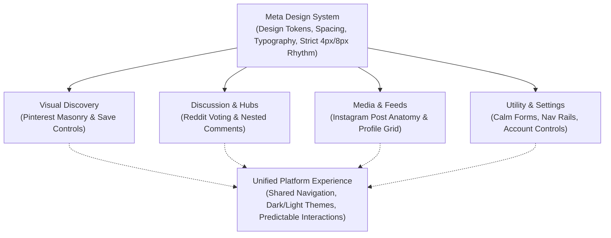
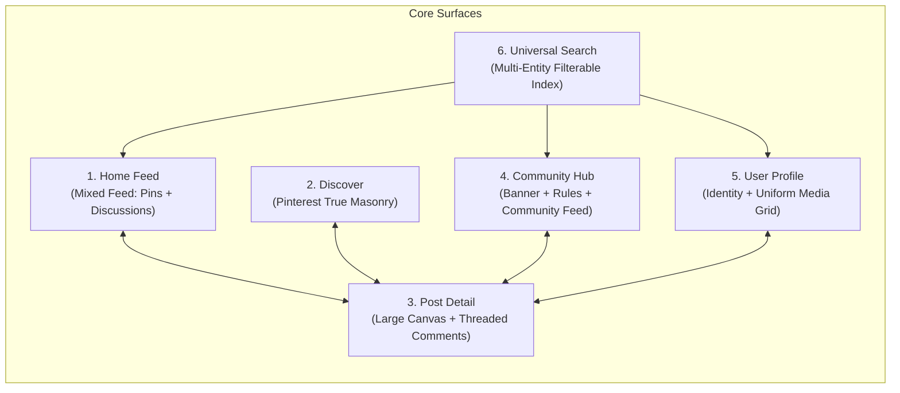

# Visual Direction Handoff: Product Experience & Page Inventory
## Social Graph & Feed Engineering Platform

**Document Status:** Final Approved Visual Design Direction & Product Surface Specification  
**Working Title:** Social Graph & Feed Engineering Platform (Brand name placeholder: *Aether / Astra / Aurelia / PulseGraph*)  
**Execution Context:** Layer 2 Product Design Specification bridging Canonical Guides (Layer 1) to Master Implementation Plan (Layer 3)  
**Reference Document:** [frontend_design_audit_and_implementation_plan.md](file:///C:/Users/saram/.gemini/antigravity/brain/2acdc78f-5c9e-4ed3-a99a-c586e5a3c7d0/frontend_design_audit_and_implementation_plan.md)  
**Historical Audit:** [signal_and_previous_projects_audit.md](file:///C:/Users/saram/.gemini/antigravity/brain/2acdc78f-5c9e-4ed3-a99a-c586e5a3c7d0/signal_and_previous_projects_audit.md)  

---

## 1. Executive Summary & Design System Boundaries

This visual direction handoff establishes the definitive user experience and spatial composition for the Social Graph & Feed Engineering Platform. It incorporates the user's latest directives, the four canonical design guides, and the five visual mockup references.

```
┌─────────────────────────────────────────────────────────────────────────────┐
│                          THREE-TIER DESIGN ARCHITECTURE                     │
├─────────────────────┬─────────────────────────────────┬─────────────────────┤
│ Tier                │ Scope & Responsibility          │ Authoritative Files │
├─────────────────────┼─────────────────────────────────┼─────────────────────┤
│ Layer 1: References │ Source of truth for documented  │ meta_DESIGN.md      │
│                     │ brand patterns, tokens, and     │ pinterest_DESIGN.md │
│                     │ platform layout conventions.    │ instagram_DESIGN.md │
│                     │                                 │ reddit_DESIGN.md    │
├─────────────────────┼─────────────────────────────────┼─────────────────────┤
│ Layer 2: Visual     │ Page inventory, composition,    │ visual_direction_   │
│    Direction Handoff│ personality modes, mockups,     │ handoff.md          │
│    (This Document)  │ and scope classification.       │ (Brain Artifact)    │
├─────────────────────┼─────────────────────────────────┼─────────────────────┤
│ Layer 3: Engineering│ Component contracts, Fastify    │ frontend_design_    │
│    Architecture &   │ API, MongoDB/Redis data models, │ audit_and_          │
│    Implementation   │ 3-tier benchmarks, 15-day road. │ implementation_plan │
└─────────────────────┴─────────────────────────────────┴─────────────────────┘
```

### Critical Boundaries
1. **Product Experience vs. Engineering Evidence:** The client-facing application is a polished, consumer-grade social platform. It contains **no in-app engineering dashboard**. Performance metrics, cache hit rates, and fan-out benchmarks are strictly exposed via automated test runners, CLI scripts, and the administrative `/api/v1/metrics` Prometheus/JSON endpoint.
2. **Canonical Markdown Guides as Authoritative Layout Truth:** The four design Markdown files ([meta_DESIGN.md](file:///c:/Users/saram/Projects/SocialGraphandFeedEngineering/meta_DESIGN.md), [pinterest_DESIGN.md](file:///c:/Users/saram/Projects/SocialGraphandFeedEngineering/pinterest_DESIGN.md), [reddit_DESIGN.md](file:///c:/Users/saram/Projects/SocialGraphandFeedEngineering/reddit_DESIGN.md), and [instagram_DESIGN.md](file:///c:/Users/saram/Projects/SocialGraphandFeedEngineering/instagram_DESIGN.md)) are the **sole authoritative specification** for layout structures, component anatomy, spacing, typography, voting rails, true masonry allocation, and responsive breakpoints.
3. **Uploaded Images as Loose Visual References Only:** The uploaded mockup images are **not** literal wireframes, templates, or UI targets to reproduce. They serve strictly as supplemental atmospheric references. No layout, column count, form styling, or interaction model is derived from the images when it differs from or is already defined by the canonical Markdown guides.
4. **No Legacy Transplanting:** In accordance with the audit of `Signal` and `Hack`, no legacy code will be copied into this project. The frontend will be built cleanly with modern React 19, Tailwind CSS tokens, and purposeful component composition.
5. **Brand Agnosticism:** The brand name remains undecided. Visual elements will use clean typography and neutral luxury tokens suitable for any candidate brand.

---

## 2. The Four Co-Equal Design Pillars & Synthesis

Rather than a disjointed patchwork or four disconnected interfaces, our design system achieves cohesion through **unified design tokens** (Meta) paired with **context-adaptive page compositions** (Pinterest, Reddit, Instagram).



### The 4 Foundation Guides:
- **[meta_DESIGN.md](file:///c:/Users/saram/Projects/SocialGraphandFeedEngineering/meta_DESIGN.md): Design System Foundation & Graph Engine**
  - Modular 4px/8px spacing rhythm (`space-1` = 4px, `space-2` = 8px, `space-4` = 16px, `space-6` = 24px).
  - Snug typography hierarchy with subtle negative letter-spacing (`-0.015em` on headings) for optical balance.
  - Strict two-tier button hierarchy (Primary filled with subtle shadow, Secondary neutral gray hover).
  - Architectural spirit of Meta's TAO social graph: write-through cache, distributed association queries, and resilient data layer.
- **[pinterest_DESIGN.md](file:///c:/Users/saram/Projects/SocialGraphandFeedEngineering/pinterest_DESIGN.md): Visual Discovery & Masonry**
  - Uncompromised true masonry layout for visual discovery: columns populated strictly via greedy shortest-column allocation (`useMasonryColumns`).
  - Cards preserve natural image aspect ratios (no crop distortion, 2:3, 1:1, 3:4).
  - Floating interaction pills on image hover: high-contrast "Save" button (top-right) and "Quick View / Share" pills.
  - Generous 16px corner radius (`rounded-2xl`) on visual pins with compact 8px desktop / 6px mobile gutters.
- **[reddit_DESIGN.md](file:///c:/Users/saram/Projects/SocialGraphandFeedEngineering/reddit_DESIGN.md): Community Context & Threaded Discussion**
  - Distinct community identity prefix (`c/{name}`) and dedicated community banner/rules canvas.
  - Bidirectional voting rail (`▲ Score ▼`) with distinct upvoted/downvoted accent highlights.
  - Threaded hierarchical comment trees with vertical collapsible guide lines, indentation, and depth limiting.
  - Community feed sorting controls: `Hot`, `New`, `Top (Today / Week / All)`, and `Rising`.
- **[instagram_DESIGN.md](file:///c:/Users/saram/Projects/SocialGraphandFeedEngineering/instagram_DESIGN.md): Creator Identity & Media Posts**
  - Classic media post card anatomy: author avatar header + location tag, high-impact media canvas, inline action bar (Heart, Comment, Share, Bookmark), and expandable caption.
  - Circular avatar hierarchy: 32px feed card, 40px comment author, 80px list rows, 150px user profile header.
  - Uniform square (1:1) and portrait (4:5) grid for personal profile tabs and creator galleries.

---

## 3. Four Deliberate Visual Personalities

To avoid making every screen look like a generic dashboard, the platform enforces four distinct visual personalities:

| Visual Personality | Target Surfaces | Density & Spacing | Imagery vs. Text | Key Interactions |
| :--- | :--- | :--- | :--- | :--- |
| **1. Visual Discovery** | Discover (`/explore`), Saved Collections | Very High density, tight 8px gutters, fluid columns | 90% Imagery, 10% Metadata | Hover-revealed overlay pills, save to board, instant lightbox zoom |
| **2. Discussion & Community** | Home Feed (`/`), Community Hub (`/c/:slug`), Post Detail | Balanced density, 16px card gaps, clear typography | 40% Media, 60% Text/Discussion | Bidirectional voting rail, nested comment collapse, sort tabs |
| **3. Profiles & Creator Media** | User Profile (`/u/:username`), Connections Directory | Structured density, 12px grid gaps, prominent header | 70% Media, 30% Bio & Stats | Follow/Unfollow toggle, message initiate, tabbed post switches |
| **4. Utility & Management** | Settings, Community Directory, Messages, Notifications, Create Post | Functional, calm forms, 16–24px section margins | 20% Media/Icons, 80% Controls | Category sidebars, toggle switches, form validation, filter chips |

---

## 4. Comprehensive Page Inventory & Visual Direction

### Part 1: Core Product Surfaces (Milestones 2–3 Scope)



#### 1. Home Feed (`/` or `/feed`) — *The Mixed Social Stream*
- **Visual Personality:** Discussion & Community (balanced with Creator Media).
- **Canonical Reference:** [reddit_DESIGN.md](file:///c:/Users/saram/Projects/SocialGraphandFeedEngineering/reddit_DESIGN.md) & [instagram_DESIGN.md](file:///c:/Users/saram/Projects/SocialGraphandFeedEngineering/instagram_DESIGN.md).
- **Layout Composition:**
  - **Left Rail (Desktop, 240px):** Primary app navigation (Home, Discover, Communities, Notifications, Messages, Saved, Profile).
  - **Center Feed (Desktop, 640px max):** Feed mode selector tabs (`For You` / `Following` / `Communities`), followed by a continuous feed containing two distinct card types:
    - `VisualPinCard`: Instagram/Pinterest media card with author header, aspect-ratio preserved image/carousel, action buttons (Like, Comment, Share, Save), and 2-line caption preview.
    - `DiscussionPostCard`: Reddit-style post card with left/top voting rail (`▲ Score ▼`), community tag badge (`c/design`), bold title, expandable text body, and comment counter.
  - **Right Rail (Desktop, 320px):** Trending topics, suggested communities to join with one-click Join buttons, and "Who to follow" creator cards.
- **Mobile Layout:** 1-column continuous stream with top sticky feed switcher and bottom 5-icon navigation bar.

#### 2. Discover (`/explore`) — *The Visual Masonry Playground*
- **Visual Personality:** Visual Discovery.
- **Canonical Reference:** [pinterest_DESIGN.md](file:///c:/Users/saram/Projects/SocialGraphandFeedEngineering/pinterest_DESIGN.md).
- **Layout Composition:**
  - **Header:** Inverted pill filter chips (e.g., `All`, `Architecture`, `UI Design`, `Typography`, `Photography`, `Digital Art`, `3D Renders`) with horizontal overflow scroll.
  - **Grid Area:** True masonry multi-column gallery (2 columns on mobile, 3 on tablet, 4 on desktop, 5–6 on ultrawide). Built strictly via shortest-column height allocation (`useMasonryColumns`).
  - **Pin Anatomy:** 16px corner radius (`rounded-2xl`), natural variable heights, 8px desktop / 6px mobile gutters.
  - **Interactions:** Hovering a pin reveals:
    - Top-right: Red/Accent "Save" pill button.
    - Bottom-right: Quick share icon and options menu pill (`···`).
    - Bottom-left: Author avatar thumbnail (24px) and handle.
  - Clicking any pin opens the dedicated Post Detail modal or route.

#### 3. Post Detail (`/post/:id`) — *The Conversation Canvas*
- **Visual Personality:** Discussion & Community.
- **Canonical Reference:** [instagram_DESIGN.md](file:///c:/Users/saram/Projects/SocialGraphandFeedEngineering/instagram_DESIGN.md) & [reddit_DESIGN.md](file:///c:/Users/saram/Projects/SocialGraphandFeedEngineering/reddit_DESIGN.md).
- **Layout Composition:**
  - **Dual-Pane Canvas (Desktop, 1200px container):**
    - **Left Media/Body Pane (65% width):** High-resolution image canvas with dark ambient backing or full discussion text body, voting rail, and creation timestamp.
    - **Right Discussion Pane (35% width):** Author header with Follow button, post caption/body, scrollable nested comments thread, and persistent bottom reply composer.
  - **Threaded Comments Hierarchy:**
    - Indented reply tree up to 4 nesting levels before flat "View more replies" accordion.
    - Vertical colored guide lines (`border-l-2 border-border/50`) showing branch continuity.
    - Thread collapse trigger (`[-]`) collapsing entire branch into a compact 1-line summary.
    - Vote buttons (`▲ ▼`), Reply button, and Timestamp on each comment node.
- **Mobile Layout:** Stacked layout with sticky media preview at top and scrollable discussion/comment sheet below.

#### 4. Community Hub (`/c/:slug`) — *A Place with Its Own Identity*
- **Visual Personality:** Discussion & Community.
- **Canonical Reference:** [reddit_DESIGN.md](file:///c:/Users/saram/Projects/SocialGraphandFeedEngineering/reddit_DESIGN.md).
- **Layout Composition:**
  - **Community Header:** Wide banner (16:9 or 4:1 banner image), overlapping circular community avatar (72px), community title (`c/webdev`), member & online counters, and high-visibility `Join / Joined` toggle button.
  - **Feed Controls:** Sort bar with icon tabs (`🔥 Hot`, `✨ New`, `🏆 Top`, `📈 Rising`) and post creation shortcut pill.
  - **Two-Column Main Area:**
    - **Left Feed (70%):** Scoped community posts (`DiscussionPostCard` and `VisualPinCard` filtered exclusively to this community). Pinned moderator announcements at top with badge.
    - **Right Sidebar (30%):** "About Community" card, Member count, Community Rules numbered list with accordion explanations, Moderator team list, and Community Guidelines.

#### 5. User Profile (`/u/:username`) — *Identity and Personal Archive*
- **Visual Personality:** Profiles & Creator Media.
- **Canonical Reference:** [instagram_DESIGN.md](file:///c:/Users/saram/Projects/SocialGraphandFeedEngineering/instagram_DESIGN.md).
- **Layout Composition:**
  - **Profile Header:** Cover banner, large circular avatar (120px desktop / 80px mobile), full display name, verified badge, `@username`, bio with clickable hashtags/links, and joined date.
  - **Social Counter Row:** Posts count, Followers count (clickable link to Connections), and Following count.
  - **Action Row:** Primary `Follow / Following` button, `Message` button, and `Share Profile` button.
  - **Tabbed Gallery:**
    - `Pins` tab: Uniform 3-column square/portrait grid with hover overlay showing like and comment counts.
    - `Discussions` tab: List of text posts authored by the user with voting scores.
    - `Saved` tab: Private collection cards (visible only to profile owner).
    - `Upvoted` tab: History of upvoted discussions (subject to privacy setting).

#### 6. Universal Search (`/search`) — *Find Anything*
- **Visual Personality:** Utility & Management (results rendered in appropriate card modes).
- **Canonical Reference:** [meta_DESIGN.md](file:///c:/Users/saram/Projects/SocialGraphandFeedEngineering/meta_DESIGN.md).
- **Layout Composition:**
  - **Persistent Header:** Prominent search input with auto-suggest dropdown for recent searches, trending hashtags, and top communities.
  - **Entity Filter Tabs:** `All`, `Pins`, `Discussions`, `People`, `Communities`, `Tags`.
  - **Results Presentation:**
    - `People` tab: 2-column grid of user cards (Avatar, Name, Handle, Bio preview, Follow button).
    - `Communities` tab: Directory cards with banner snippet, member count, and Join button.
    - `Pins` tab: Masonry grid of matching visual posts.
    - `Discussions` tab: Ranked discussion list matching query terms.

---

### Part 2: Supporting Product Surfaces (Milestones 4–5 Scope)

#### 7. Notifications (`/notifications`) — *Activity Inbox*
- **Visual Personality:** Utility & Management.
- **Canonical Reference:** [instagram_DESIGN.md](file:///c:/Users/saram/Projects/SocialGraphandFeedEngineering/instagram_DESIGN.md) & [meta_DESIGN.md](file:///c:/Users/saram/Projects/SocialGraphandFeedEngineering/meta_DESIGN.md).
- **Layout Composition:**
  - Clean chronological activity list with time groupings: `Today`, `This Week`, `Earlier`.
  - Filter pills: `All`, `Mentions`, `Follows`, `Replies`, `Likes & Votes`.
  - Compact row anatomy: Actor avatar (40px) with activity badge overlay (Heart icon, Reply bubble, Follow user icon), actor name in bold, descriptive string, target post thumbnail (44px square) on right.
  - Inline action: `Follow Back` button for new follower items.

#### 8. Messages (`/messages`) — *Private Direct Conversations*
- **Visual Personality:** Utility & Management.
- **Canonical Reference:** [meta_DESIGN.md](file:///c:/Users/saram/Projects/SocialGraphandFeedEngineering/meta_DESIGN.md) & [instagram_DESIGN.md](file:///c:/Users/saram/Projects/SocialGraphandFeedEngineering/instagram_DESIGN.md).
- **Layout Composition:**
  - **Dual-Pane Split (Desktop):**
    - **Left Conversation Pane (360px):** Active threads, unread badge counter, search conversation field, and message requests tab.
    - **Right Chat Pane (Flexible):** Active thread header with recipient avatar, status, and profile link. Message bubble history (outbound colored accent, inbound neutral surface).
  - **Composer:** Persistent bottom composer with media attachment icon, emoji picker, and send button.

#### 9. Create Post (`/create`) — *Dedicated Publishing Workspace*
- **Visual Personality:** Utility & Management.
- **Canonical Reference:** [pinterest_DESIGN.md](file:///c:/Users/saram/Projects/SocialGraphandFeedEngineering/pinterest_DESIGN.md) & [reddit_DESIGN.md](file:///c:/Users/saram/Projects/SocialGraphandFeedEngineering/reddit_DESIGN.md).
- **Layout Composition:**
  - Mode Switcher Tabs: `Visual Pin` vs. `Discussion Post`.
  - **Visual Pin Creator:**
    - Left side (60%): Drag-and-drop media upload zone with live preview and aspect ratio indicator.
    - Right side (40%): Title input, caption textarea, destination collection dropdown, optional community tag, and alt-text field for accessibility.
  - **Discussion Post Creator:**
    - Full-width editor: Community selector dropdown (`Select a community`), post title field (300 char max), rich Markdown body editor with preview tab, and post flair tags.
  - **Footer Action Bar:** Draft auto-save indicator, `Save Draft` button, and primary `Publish` button.

#### 10. Saved & Collections (`/saved`) — *Personal Curation Library*
- **Visual Personality:** Visual Discovery & Personal Library.
- **Canonical Reference:** [pinterest_DESIGN.md](file:///c:/Users/saram/Projects/SocialGraphandFeedEngineering/pinterest_DESIGN.md).
- **Layout Specification (Derived from `pinterest_DESIGN.md`):**
  - **Top Collection Shelf:** Horizontal scrollable shelf of user-curated collections with cover previews, title, and item count.
  - **Action Header:** Create new collection trigger, visibility filter, and sort options.
  - **Gallery Canvas:** Masonry grid of saved visual pins and bookmarked discussions with hover quick-actions.

#### 11. Connections / Followers & Following (`/u/:username/connections`) — *Relationship Directory*
- **Visual Personality:** Utility & Management.
- **Canonical Reference:** [instagram_DESIGN.md](file:///c:/Users/saram/Projects/SocialGraphandFeedEngineering/instagram_DESIGN.md) & [meta_DESIGN.md](file:///c:/Users/saram/Projects/SocialGraphandFeedEngineering/meta_DESIGN.md).
- **Layout Specification (Derived from `instagram_DESIGN.md` & `meta_DESIGN.md`):**
  - **Header Tabs:** `Followers` and `Following` with live count badges.
  - **Filter Bar:** Instant client-side search input for filtering users in the current tab.
  - **Directory Rows:** 48px circular avatar, display name, `@handle`, bio snippet, and two-state `Follow / Following` button adhering to Meta button hierarchy.
  - **Suggested Rail:** Secondary rail for graph-based connection recommendations.

#### 12. Settings (`/settings`) — *Account Control Center*
- **Visual Personality:** Utility & Management.
- **Canonical Reference:** [meta_DESIGN.md](file:///c:/Users/saram/Projects/SocialGraphandFeedEngineering/meta_DESIGN.md).
- **Layout Specification (Derived from `meta_DESIGN.md`):**
  - **Navigation Sidebar (240px):** Categorized navigation (`Account`, `Appearance`, `Privacy`, `Notifications`, `Security`).
  - **Form Content Canvas:** Structured card-based sections with 16px/24px padding using Meta design tokens.
  - **Theme Controls:** Explicit `Light`, `Dark`, and `System` options with immediate token switching.
  - **Safety & Destructive Actions:** Isolated danger zone card with prominent confirmation modals.

#### 13. Community Directory (`/communities`) — *Curated Discovery*
- **Visual Personality:** Utility & Management.
- **Canonical Reference:** [reddit_DESIGN.md](file:///c:/Users/saram/Projects/SocialGraphandFeedEngineering/reddit_DESIGN.md).
- **Layout Specification (Derived from `reddit_DESIGN.md`):**
  - **Top Discovery Bar:** Topic chips and community search filter.
  - **Curated Sections:** Featured and growing community cards displaying banner, avatar, subscriber count, and Join/Leave toggle.
  - **Sidebar:** "My Communities" quick navigation and "Create Community" action button.

---

### Part 3: Optional Product Extensions (Post-Milestone 5 Scope)

#### 14. Story / Ephemeral Media Viewer (`/stories/:userId`)
- **Visual Personality:** Immersive Full-Screen Media.
- **Canonical Reference:** [instagram_DESIGN.md](file:///c:/Users/saram/Projects/SocialGraphandFeedEngineering/instagram_DESIGN.md).
- **Layout Specification (Derived from `instagram_DESIGN.md`):**
  - Full-screen 9:16 vertical media container with high-contrast darkened backdrop.
  - Segmented progress bar timer across top.
  - Creator header overlay with avatar, handle, and close action.
  - Bottom reply input overlay with reaction triggers.
- **Product Classification:** **Explicitly Optional / Deferred Extension.** All core social feed engineering and discussion benchmarks take complete precedence.

---

### Part 4: System Flows & Edge States Checklist

To ensure a resilient, end-to-end product experience, the following supporting flows and states are cataloged and aligned with the design token system:

1. **Authentication (`/login`, `/register`):** Minimalist card layout, email/password fields, OAuth mock buttons, validation messaging, and terms footer.
2. **Onboarding & Interest Picker (`/onboarding`):** 3-step sequence: avatar upload, topic selection chips (minimum 3), and suggested initial communities to join. Fully skippable.
3. **Edit Profile Modal (`/profile/edit`):** Accessible dialog to update display name, biography, avatar, banner, and external link.
4. **Create Community Modal (`/community/create`):** Guided modal with community name (slug validation `c/{name}`), description, topic tag, and privacy toggle (Public vs Restricted).
5. **Collection Detail View (`/saved/:collectionId`):** Scoped gallery with collection title, curator badge, edit description, and masonry pin stream.
6. **Lightbox / Fullscreen Media Modal:** High-contrast backdrop modal triggered when clicking a media pin, featuring zoom, pan, and escape-to-close keyboard listeners.
7. **Share & Bookmark Dialogs:** Compact floating dropdown/modal allowing one-click link copying and targeted saving into specific collections.
8. **Comment Moderation & Reporting:** Action menus on posts and comments: `Report`, `Block User`, `Mute Community`, and moderator `Remove Post`.
9. **Account Recovery & Password Reset (`/forgot-password`, `/reset-password`):** Clean single-input forms with token expiration validation.
10. **Empty, Loading & Error States:**
    - Feed empty state: friendly illustration and "Find communities or creators to follow" CTA.
    - Loading skeletons: animated pulsing skeletons matching exact card geometry (`VisualPinCardSkeleton` with varied aspect ratios, `DiscussionPostCardSkeleton` with vote rails).
    - Offline / Redis Fallback banner: subtle non-blocking status pill indicating live fallback feed mode.
11. **Responsive Breakpoints:**
    - Desktop (`>= 1280px`): Full 3-column layout (Nav rail + Main feed + Info/Trending rail).
    - Tablet (`768px – 1279px`): Compact icon-only nav rail, main feed, right rail collapses or moves below.
    - Mobile (`< 768px`): Top app bar with search, full-width single-column feed, sticky bottom navigation bar (Home, Explore, Create, Notifications, Profile).

---

## 5. Scope Classification & Technical Feasibility Matrix

To protect the 15-day timeline and prevent scope creep, all 14 surfaces and system flows are classified into three strict tiers:

```mermaid
graph TD
    subgraph Tier 1: Core Product Surfaces (M1-M3)
        C1["Home Feed (Mixed Feed)"]
        C2["Discover (Masonry)"]
        C3["Post Detail & Comments"]
        C4["Community Hub"]
        C5["User Profile"]
        C6["Universal Search"]
    end

    subgraph Tier 2: Supporting Product Surfaces (M4-M5)
        S1["Saved & Collections"]
        S2["Connections Directory"]
        S3["Settings & Themes"]
        S4["Community Directory"]
        S5["Notifications Inbox"]
        S6["Messages (1:1 Text)"]
        S7["Create Post Workspace"]
    end

    subgraph Tier 3: Optional Extensions (Post-M5)
        O1["Story / Ephemeral Media Viewer"]
        O2["Video Chunk Transcoding"]
        O3["WebSocket Live Presence"]
        O4["Group Direct Messaging"]
    end
```

| Surface / Feature | Tier | 15-Day Plan Status | Engineering Feasibility & Implementation Boundary |
| :--- | :--- | :--- | :--- |
| **Home Feed** | **Core** | **Milestone 2** | Primary testbed for Fan-out on Read vs. Write benchmarks. Hybrid post cards. |
| **Discover (Masonry)** | **Core** | **Milestone 3** | True masonry with `useMasonryColumns` hook, aspect ratio preservation, zero voids. |
| **Post Detail** | **Core** | **Milestone 2** | Dual-pane canvas, nested comments tree with collapse controls. |
| **Community Hub** | **Core** | **Milestone 3** | Scoped feeds, community rules, member counters, moderator tags. |
| **User Profile** | **Core** | **Milestone 3** | Social stats, identity header, uniform 1:1 media grid tab, discussions tab. |
| **Universal Search** | **Core** | **Milestone 3** | Multi-entity indexing for posts, users, and communities via MongoDB text/regex index. |
| **Saved & Collections** | **Supporting** | **Milestone 4** | Relational bookmarking in MongoDB with collection shelves and pin assignments. |
| **Connections** | **Supporting** | **Milestone 4** | Follow/Following relationship lists, mutual follower calculations. |
| **Settings & Themes** | **Supporting** | **Milestone 4** | LocalStorage/MongoDB sync for appearance tokens (Light/Dark/System) & privacy toggles. |
| **Community Directory** | **Supporting** | **Milestone 4** | Curated catalog with category filters and join toggles. |
| **Notifications Inbox** | **Supporting** | **Milestone 5** | REST-polled activity inbox with unread counts and grouped timestamps. |
| **Direct Messages** | **Supporting** | **Milestone 5** | 1:1 text messaging via Fastify REST endpoints. (WebSockets optional if time permits). |
| **Create Post Workspace**| **Supporting** | **Milestone 2** | Tabbed publisher for Visual Pins (image URL/upload) and Discussions (Markdown). |
| **Auth & Onboarding** | **Supporting** | **Milestone 1–2** | JWT cookie-based session auth, interest picker chips, clean error alerts. |
| **Stories Viewer** | **Optional** | **Post-M5 Extension** | Edge-to-edge media viewer. Feasible as a client-side prototype, but deferred to post-M5. |
| **Video Transcoding** | **Optional** | **Excluded** | Video uploads will use direct URLs or external embeds; no distributed transcoding pipeline. |
| **Live Presence Sync** | **Optional** | **Post-M5 Extension** | Redis Pub/Sub presence is secondary; simple "Last seen" timestamps suffice for core. |

> [!IMPORTANT]
> **Strict Feasibility Boundary:** Core product surfaces (Surfaces 1–6) and feed/graph reliability mechanisms take absolute priority. Supporting surfaces (Surfaces 7–13) are strictly sequenced for later milestones (Milestones 4–5) and will **never silently expand or jeopardize** the core feed engine, benchmark suite, or reliability test gates.

---

## 6. Handoff Alignment & Implementation Readiness

This visual handoff directly validates and aligns with the technical contracts specified in the Master Implementation Plan:

1. **Card Component Separation:**
   - Visual Discovery and media-first posts use `<VisualPinCard />` implementing [pinterest_DESIGN.md](file:///c:/Users/saram/Projects/SocialGraphandFeedEngineering/pinterest_DESIGN.md) (16px radius, floating pills, natural aspect ratios).
   - Discussion and community-first posts use `<DiscussionPostCard />` implementing [reddit_DESIGN.md](file:///c:/Users/saram/Projects/SocialGraphandFeedEngineering/reddit_DESIGN.md) (vote rails, community badges, structured metadata).
2. **Masonry Layout Engine:**
   - Implements the greedy shortest-column allocation hook `useMasonryColumns` documented in [frontend_design_audit_and_implementation_plan.md](file:///C:/Users/saram/.gemini/antigravity/brain/2acdc78f-5c9e-4ed3-a99a-c586e5a3c7d0/frontend_design_audit_and_implementation_plan.md), eliminating the row-locking voids diagnosed in [signal_and_previous_projects_audit.md](file:///C:/Users/saram/.gemini/antigravity/brain/2acdc78f-5c9e-4ed3-a99a-c586e5a3c7d0/signal_and_previous_projects_audit.md).
3. **Execution Gate:**
   - Planning is now fully finalized. 
   - We are ready to commence **Milestone 1: Project Foundation & Shared Contract Baseline** (React 19 + Vite frontend scaffolding, Fastify TypeScript backend scaffolding, shared schema contracts, Docker Compose MongoDB + Redis, and health-check integration verification).
